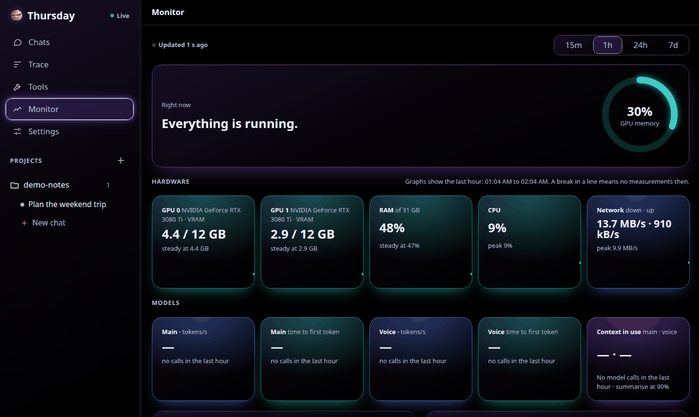
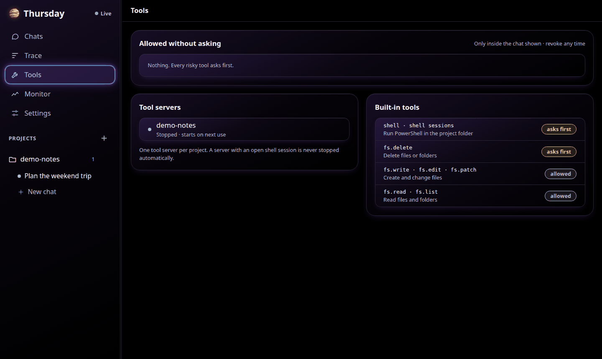
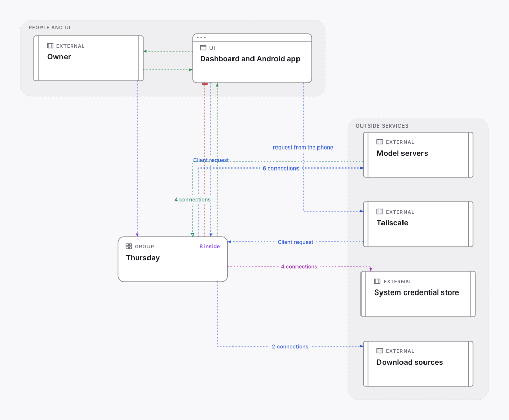
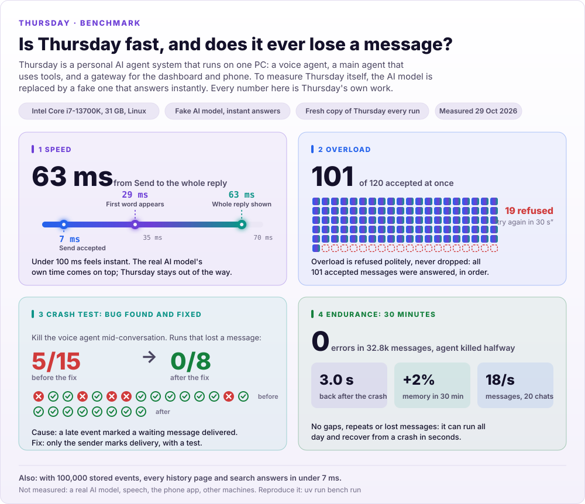
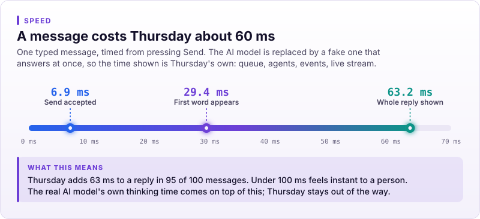
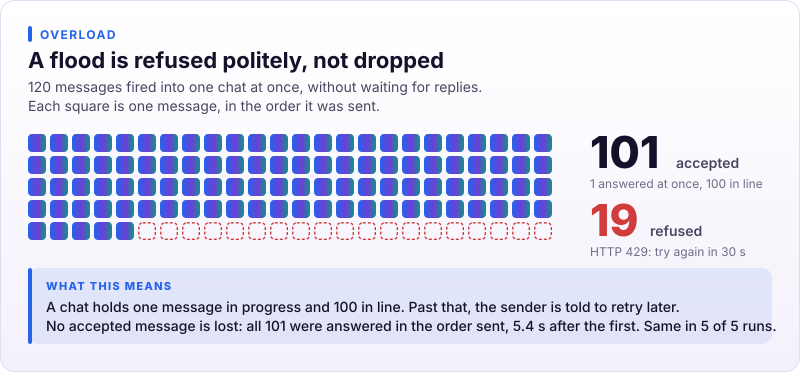
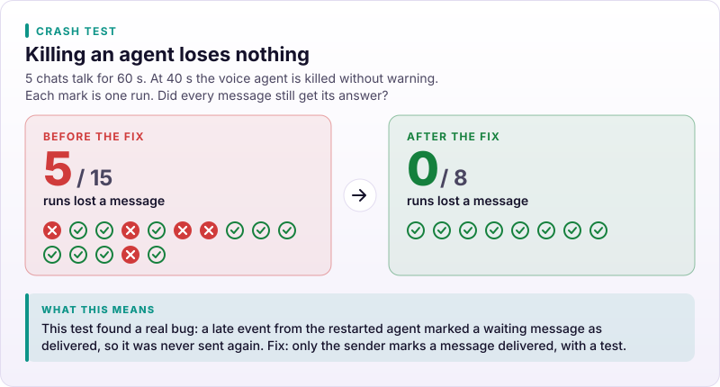
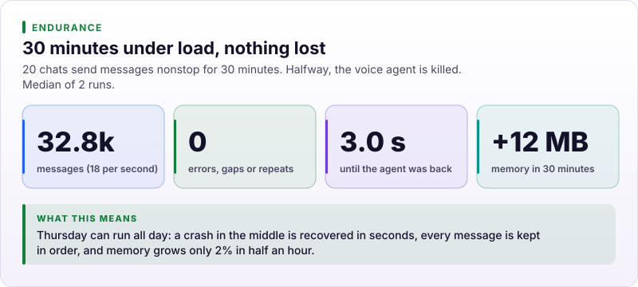

<p align="center"></p>

# Thursday

**Does your local agent leave you staring at one chat box while it works?**

Thursday is a personal agent harness for your own PC. It splits the work between two agents, so you can keep talking while a task runs, and it asks you before any risky step.

A small, fast voice agent takes your short instructions and hands them to a main agent. The main agent carries them out with tools on your PC. A dashboard and an Android app show every step live and let you approve, pause, or stop a task.

<p align="center">
  
  
</p>

<p align="center"><sub>The dashboard on the PC: the Monitor screen, and the Tools screen where risky tools ask first. Both are real screenshots, with a made-up project.</sub></p>

## What it does

- Chat or talk with a voice agent that delegates tasks to a main agent over the A2A protocol.
- Or switch a chat to **Direct** and send your words straight to the main agent, unchanged; the voice agent only reports the result.
- The main agent runs tools on your PC through MCP tool servers, including a built-in one for files and shell.
- Each task shows as a card that opens into its steps, live: every delegation, LLM call, tool call (purple while it runs, then green or red), approval, and result. A Trace screen keeps the full detail, with each model call's request and response laid out as a readable conversation.
- Risky actions ask you first: allow once, allow always for that chat, or deny.
- Pause, resume, and stop a running task from the UI or by asking the voice agent.
- Projects with their own folders, each holding many chats, with search and history. Deleting a chat or project removes every record of it.
- A web dashboard on the PC and a native Android app for phones and tablets, upright or lying down, reached over Tailscale, with notifications when the device is locked.
- Talk instead of typing: push-to-talk and replies read aloud (Kokoro) piece by piece, so the voice starts before the whole reply is ready, all running locally. When the voice agent's model can hear (a built-in llama.cpp model with an audio projector), it writes down what you said itself; otherwise Whisper does, on the CPU.
- A voice field behind the chat: a line of particles that drifts like a breeze and pulses with sound, and a face made of particles that gathers while Thursday listens, thinks, and speaks (it can be switched off).
- Monitoring: tokens per second and time to first token for each agent, context use, latency, VRAM, RAM, CPU, network, queues, and how much data is stored.
- You choose how long working data is kept (task steps, traces, tool call logs): from 7 days to a year, or until you delete it. Chats stay until you delete them.
- A model provider per agent, chosen in Settings: **LM Studio**, the **built-in llama.cpp** (Thursday starts and stops it), or any **OpenAI-compatible** endpoint. The model is picked from the provider's own list, with load settings, answer settings, and a context limit for each agent. Nothing is loaded until you load it or first use it, Unload frees the hardware, and a model nobody has used for five minutes (your choice per agent) is unloaded by itself.
- API keys are typed in Settings and kept in the operating system's credential store, never in a file.

## How it works

You talk to the voice agent through the gateway. It turns your instruction into an A2A task for the main agent, which plans and calls tools through MCP. Progress and approval requests flow back as events to the gateway, which feeds the dashboard and the phone. Each service owns its own data; the gateway keeps a read model of events for the screens. Speech is a separate local service: the gateway has your recording transcribed and the text is sent as a normal message.

<picture>
  <source media="(prefers-color-scheme: dark)" srcset="docs/images/architecture-dark.svg">
  
</picture>

The picture is level 1 of the [architecture model](docs/architecture/index.html), which opens level by level down to each condition and journey.

Detailed design: [architecture](docs/ARCHITECTURE.md), [flows](docs/FLOWS.md), [contracts](docs/API.md), [security](docs/SECURITY.md). Running and maintaining it: [operations](docs/OPERATIONS.md).

## How it integrates

- An LLM endpoint for each agent: LM Studio on the PC, the built-in llama.cpp (downloaded by setup, serving `.gguf` files from a folder you choose), or any OpenAI-compatible service (a cloud provider, or a llama.cpp server you run yourself). A cloud provider sends everything in the model context off your PC.
- The operating system's credential store for API keys (Windows Credential Manager, macOS Keychain, or Linux Secret Service).
- MCP tool servers started as local stdio processes.
- Tailscale for the phone connection, with HTTPS certificates enabled on your tailnet.
- Local speech models (Whisper and Kokoro), downloaded once on first use.

Contracts and integration notes are in [docs/API.md](docs/API.md).

## Requirements

- A Windows 11 or Linux PC with a GPU suitable for the models you choose. On Linux, also install [PowerShell 7](https://learn.microsoft.com/powershell/scripting/install/installing-powershell) (`pwsh`): the shell tool runs its commands in PowerShell
- A model source: LM Studio, or `.gguf` model files for the built-in llama.cpp, or an OpenAI-compatible endpoint
- [uv](https://docs.astral.sh/uv/) (it installs Python 3.12 if needed)
- Node.js 20 or newer to build the dashboard
- Disk space: about 0.9 GB for the speech models on first use of voice, and about 650 MB for the built-in llama.cpp on a PC with an NVIDIA card (about 35 MB otherwise)
- For the phone: Tailscale on the PC and the phone, and an Android phone (Android 11 or newer)
- To build the Android app yourself: a JDK 21 and the Android SDK

## Quick start

Get the code (Code, Download or Clone, on GitHub) and open a terminal in its folder. Then:

```bash
python3 scripts/setup.py
```

On Windows, type `python scripts/setup.py`. The script checks the tools in Requirements, makes `.env` and the service token, installs the Python and dashboard packages, builds the dashboard, and checks that everything it needs is here. It asks only for the model server addresses and the models folder. Run it again at any time: it keeps your `.env` and repeats only what is needed. `python3 scripts/setup.py --yes` asks nothing and takes the example values.

```bash
uv run thursday up
```

Open http://127.0.0.1:8700, go to **Settings, Agents**, and choose a model for each agent (see [Models and API keys](#models-and-api-keys)). The built-in llama.cpp is optional and about 650 MB: `uv run thursday setup` offers it.

`python3 scripts/check.py` runs every automated check: lint, types, tests, the architecture model, and the dashboard checks. The steps under Installation do the same by hand.

## Configuration

`.env.example` lists every setting with a comment. `.env` is yours and is never committed. Most settings can also be changed in Settings in the dashboard, and API keys are never kept in `.env`.

| Setting | What it does | Default |
|---|---|---|
| `THURSDAY_SERVICE_TOKEN` | Lets the services trust each other. Setup makes it. | made by setup |
| `THURSDAY_DATA_DIR` | Where databases and logs go | the per-user data folder |
| `VOICE_LLM_PROVIDER`, `MAIN_LLM_PROVIDER` | `lmstudio`, `llamacpp`, or `openai_compatible` | `lmstudio` |
| `VOICE_LLM_BASE_URL`, `MAIN_LLM_BASE_URL` | The model server's address | `http://localhost:1234` |
| `LLAMACPP_MODELS_DIR` | The folder searched for `.gguf` files | empty |
| `LLM_IDLE_UNLOAD_MINUTES` | Minutes before an idle model is unloaded; 0 keeps it loaded | 5 |
| `GATEWAY_LOCALHOST_PORT` and the other `*_PORT` settings | The ports the services use on this PC | 8700 to 8730 |

## Troubleshooting

| Problem | Cause and fix |
|---|---|
| `setup.py` stops with "pwsh is not installed" | On Linux the shell tool needs PowerShell 7. Install it from the address the script prints, then run setup again. |
| `setup.py` stops with "uv is not installed" or "node is not installed" | Install the tool from the address the script prints, open a new terminal, and run setup again. |
| `uv run thursday check` shows a note about the credential store | This system has none, so API keys cannot be saved. Install a Secret Service such as GNOME Keyring on Linux. Model servers that need no key still work. |
| `thursday up` says a service is "already running, started elsewhere" | Another Thursday is using those ports. Stop it with `uv run thursday down`, or give a second copy its own `THURSDAY_DATA_DIR` and `*_PORT` settings. |
| A message stays queued and a banner says the LLM endpoint is unreachable | The model server is not running, or the address in Settings is wrong. Start LM Studio and its server, or fix the address. |

More causes and fixes are in [docs/OPERATIONS.md](docs/OPERATIONS.md).

## Installation

### Windows 11

1. Install the Python packages:

```bash
uv sync
```

2. Run setup. It creates `.env` from `.env.example` and generates the service token. It then asks whether you want the built-in llama.cpp, saying how large it is; a yes downloads the official build for this PC (CUDA for an NVIDIA card, otherwise Vulkan, otherwise CPU), checked against the SHA-256 the release publishes. Say no if you will only use LM Studio or a cloud endpoint. It ends with a list of what Thursday needs on this PC and what is still missing, with what to do about each.

```bash
uv run thursday setup
```

3. Build the dashboard (and again after updating Thursday):

```bash
npm ci --prefix apps/dashboard
```

```bash
npm run build --prefix apps/dashboard
```

4. Start everything:

```bash
uv run thursday up
```

This starts the gateway, voice agent, main agent, metrics collector, and speech service as native processes on localhost, checks their health, and restarts any that crash. The main agent starts the built-in tool server for each project on demand. No model is loaded at start.

5. Open the dashboard at http://127.0.0.1:8700 and go to **Settings, Agents**. For each agent choose the provider, then the address (LM Studio or a cloud endpoint) or the models folder (built-in llama.cpp), save, and pick the model from the list. If the endpoint needs a key, type it in the API key box. Then add a project folder under Chats and send a message.

If something is missing (the dashboard was not built, a port is taken), `up` says so before it starts. To see the whole list at any time:

```bash
uv run thursday check
```

To stop everything, press Ctrl+C in that terminal, or run this from any terminal:

```bash
uv run thursday down
```

It asks the running supervisor to shut the services down cleanly, force-stops any service left behind, and stops any built-in llama.cpp server an agent left running. To check them once from another terminal:

```bash
uv run thursday status
```

Data and logs go to `%LOCALAPPDATA%\Thursday` unless `THURSDAY_DATA_DIR` is set. Updating, backups, logs, and troubleshooting are covered in [docs/OPERATIONS.md](docs/OPERATIONS.md).

### Linux

The steps are the same as on Windows, with `python3 scripts/setup.py` as a guided first step: it checks for `pwsh` and the other tools and says what is missing. Data and logs go to `~/.local/share/thursday` unless `THURSDAY_DATA_DIR` is set. While a task runs, Thursday asks the PC not to sleep: a power request on Windows, a systemd inhibitor lock on Linux (sleep and idle, or idle alone where the session may not block sleep). Nothing is requested on macOS, which is not a supported target for version 1.

### Reaching Thursday from your phone

The phone connects over Tailscale to the gateway's proxy port, which always requires a paired device token. With HTTPS certificates enabled on your tailnet, publish the proxy port inside your tailnet (not to the internet):

```bash
tailscale serve --bg http://127.0.0.1:8701
```

Then open Settings, Devices in the dashboard and make a pairing code. The code is made only on the PC, works once, and expires after five minutes; the dashboard shows it as text and as a QR code. The dashboard shows this PC's tailnet address, found with `tailscale status`; set `GATEWAY_PUBLIC_URL` in `.env` to override it.

### Android app

Download the signed APK `Thursday-1.0.0.apk` from the [latest release](https://github.com/mugilnimbus/Thursday_V3/releases/latest). Its SHA-256 is `82c1544f99d13547c1d2829e4d8314d1c1e3bbb5e021ee1a84df0eac1f67be01`. Check the file before you install it: run `sha256sum Thursday-1.0.0.apk` on Linux, or `Get-FileHash Thursday-1.0.0.apk` in Windows PowerShell, and compare the result. Copy the APK to a phone that is on your tailnet and install it (Android asks you to allow installing from this source the first time), open Thursday, and scan the pairing code from the dashboard. Each phone pairs separately and can be revoked in Settings, Devices.

To build the APK yourself, from `apps/android` with a JDK 21 in `JAVA_HOME`:

```bash
./gradlew :app:assembleRelease
```

The signed APK is written to `app/build/outputs/apk/release/app-release.apk`. Signing reads `apps/android/keystore.properties` (`storeFile`, `storePassword`, `keyAlias`, `keyPassword`), which is ignored by git along with the key file; without it the release build is left unsigned. Keep the key and its password backed up somewhere safe: a phone only accepts an update signed with the same key. A debug build (`./gradlew :app:assembleDebug`) needs no key but cannot replace a release build on a phone without uninstalling it first.

## Models and API keys

Each agent (voice and main) has its own provider, model, and settings, changed in **Settings, Agents** on the dashboard or in **Settings, Main agent / Voice agent** on the phone. `VOICE_LLM_*` and `MAIN_LLM_*` in `.env` only give the starting values.

| Provider | What you give it | Loading |
|---|---|---|
| LM Studio | Its server address | Thursday loads and unloads the model through LM Studio, with your load settings |
| Built-in llama.cpp | The folder that holds your `.gguf` files | Thursday starts one `llama-server` per agent when the model is loaded and stops it on unload, which frees the GPU. A projector file (`mmproj*.gguf`) beside the model is used automatically. A model too large for one graphics card is split across the cards by layer, and what does not fit runs on the CPU. You can have one card filled first, so a model that fits one card leaves the other card free |
| OpenAI-compatible | The endpoint address and, usually, a key | Nothing to load; a cloud endpoint is always marked as sending data off the PC |

**API keys** are not kept in a file. Type a key in the agent's API key box and save; it goes into the operating system's credential store (Windows Credential Manager), encrypted for your account, and is never shown again. Settings only says whether one is set. Each agent keeps one key per provider, so switching an agent from LM Studio to a cloud endpoint never sends one's key to the other. On the phone, saving asks for your fingerprint or PIN first.

**Settings per agent.** Load settings (context length, batch size, flash attention, KV cache, and for llama.cpp which graphics cards to use, whether to spread a model over them or fill one card first, how many layers go on them, and the expert layers kept off them) apply the next time the model loads. **Unload when not used for** sets how long a loaded model may sit idle before it is unloaded (five minutes unless you change it; Never keeps it loaded). Answer settings (temperature, top p, output limit, thinking or reasoning effort) apply to the next call. Each list names the engine's default first. The **context limit** says how many tokens of conversation an agent sends before the main agent summarises older turns, or the voice agent leaves them out; a cloud endpoint does not report its window, so this is the only limit there.

`THURSDAY_SERVICE_TOKEN` in `.env` is generated by setup and is used only between Thursday's own services; do not share it.

## Benchmark

<picture>
  <source media="(prefers-color-scheme: dark)" srcset="docs/images/bench-overview-dark.svg">
  
</picture>

The benchmark measures Thursday's own work. A fake AI model answers at once, so every number is the time and the safety of Thursday's queue, agents, events and live stream. A real model adds its own time on top.

<details>
<summary><b>The four results in detail</b></summary>
<br>

<picture>
  <source media="(prefers-color-scheme: dark)" srcset="docs/images/bench-message-time-dark.svg">
  
</picture>

<picture>
  <source media="(prefers-color-scheme: dark)" srcset="docs/images/bench-burst-dark.svg">
  
</picture>

<picture>
  <source media="(prefers-color-scheme: dark)" srcset="docs/images/bench-kill-test-dark.svg">
  
</picture>

<picture>
  <source media="(prefers-color-scheme: dark)" srcset="docs/images/bench-soak-dark.svg">
  
</picture>

</details>

| What | Result |
|---|---|
| Send a message, `POST` to `202` | p95 6.9 ms |
| Message to first token of the reply | p95 29 ms |
| Message to full reply (249 characters) | p50 53 ms, p95 63 ms |
| Event written by an agent to the stream message that carries it | p95 14 to 30 ms |
| 120 messages sent into one chat at once | 101 accepted, 19 refused with `429` and `Retry-After: 30`; all 101 answered, in order, 5.4 s after the first |
| 20 chats sending for 5 minutes | 18.8 messages per second, 0 errors, reply p95 1.1 s (the messages queue behind each other), service memory 549 MB to 558 MB |
| 30 minutes of the same load, voice agent killed at the half | about 32,700 messages per run, 0 errors, 0 gaps or repeats in event numbers, agent back after 3.0 s, memory 549 MB to 561 MB |
| Reads with 100,000 stored events (64 MB on disk) | latest 50 messages p95 0.9 ms; timeline page of 200 events p95 2.5 ms; search for a rare word p95 6.9 ms |
| Events accepted by the gateway | about 31,000 per second |

**How it was measured.** 2026-10-29, on an Intel Core i7-13700K with 30.6 GB, Linux 7.0 and Python 3.12, with the PC idle (under 3% CPU). Each figure is the median of separate runs, each from a fresh copy of Thursday: 5 runs, 3 for the 5-minute load and 2 for the 30-minute run. A second pass of the short workloads gave the same figures: of 154 medians compared, 7 differed by more than 20%, all of them single slow requests under 15 ms. The table runs came before the kill-test fix. The kill-test chart counts short runs of 5 chats for 60 seconds.

**Limits.** One PC and one operating system were measured. The tool server, speech, the phone and the dashboard were not. A real model adds its own time to every reply.

**Run it yourself.** Stop Thursday first (`uv run thursday down`), then run `uv run bench run`. The run starts its own copy of Thursday on spare ports (187xx), with a scratch data folder and the fake model. `--quick` is a short check that the harness works. `uv run bench charts` draws these charts from the saved results. The plan is in [bench/README.md](bench/README.md).

## Status and limitations

- The services, the dashboard, and the Android app work end to end on Windows 11 and Android 15 with LM Studio.
- On Linux the Python tests (`uv run pytest`), the type check, the lint, and the dashboard tests and build pass. The shell tool's tests also pass on Linux with `pwsh` 7.6 installed. The five services also start and stay healthy on Linux, and the dashboard is served; a project, a chat and a queued message (with no model server running) behave as designed, and the monitor reports CPU, RAM and both GPUs. Speech, the browser UI, and the Android app have not been tried on Linux.
- The built-in llama.cpp has been run on Windows on a PC with two NVIDIA cards (CUDA build, Gemma 4 E4B and 12B): install, model list, load and unload on a chosen GPU, text, tool calls, and a spoken question through Whisper to the voice agent and on to the main agent. On Linux (Ubuntu, two RTX 3080 Ti, CUDA 12.8 build b11960, Gemma 4 E4B) setup installed it, both agents loaded the model on the GPUs, the voice agent answered a message, a direct message ran as a task on the main agent, and Unload freed the GPU memory. The Vulkan and CPU builds have not been run.
- Voice is push-to-talk with replies read aloud, on the dashboard and the phone; the first use downloads the speech models (about 0.5 GB for Whisper `small` and 0.35 GB for Kokoro). Continuous listening is not built. A model that hears writes down what you said and then answers that text; it does not answer the audio in one step.
- Across several graphics cards, llama.cpp splits a model by layer (the cards work one after the other). Its two parallel split modes do not load on NVIDIA cards in the build setup installs, so they are not offered.
- OpenAI's server-side context compaction is not used; Thursday summarises with the model itself.
- On the phone the speaking face moves to a speech-like pattern, not the actual audio; on the dashboard it follows the audio.
- Restoring a backup was tried on Linux with a project and a chat: both came back with their original ids. Message and task contents were not compared.
- Windows 11, Linux, and Android are the supported targets for version 1. macOS is not.

## Project structure

Thursday is one repository with a folder for each part. The Python parts form a single [uv workspace](https://docs.astral.sh/uv/concepts/projects/workspaces/) that shares one `uv.lock`; each is its own package with one job and a short list of things it may depend on. Services never import each other: they talk over HTTP, A2A, and MCP, and share only the small packages marked below.

```text
thursday/
├── README.md                    this page
├── LICENSE                      Apache License 2.0
├── pyproject.toml               the uv workspace: lists every Python package below
├── uv.lock                      pinned versions of all Python dependencies
├── .python-version              Python 3.12
├── .env.example                 every setting with example values; copied to .env by setup (never committed)
├── .gitignore  .gitattributes   what git leaves out; line endings and binary files
├── scripts/                     setup.py and check.py (guided setup), render-diagrams.mjs
│
├── contracts/                   the messages services send each other (shared)
│   ├── src/thursday_contracts/      event envelope, approvals, health, metrics, problems, task control
│   ├── schemas/                     committed JSON Schema of each message (guards against accidents)
│   └── tests/
│
├── packages/                    shared plumbing, used by the services
│   ├── runtime/                     settings from .env, data and log folders, JSON logging, health routes,
│   │                                service-token auth, the event outbox, backups, the credential store
│   └── llm/                         talking to a model: the three providers (LM Studio, built-in llama.cpp,
│                                    OpenAI-compatible), model loading, per-agent settings and keys,
│                                    request capture, reading a streamed response, stream timing
│
├── services/                    the programs that run (each: src/<name>/ with the layers it needs out of
│   │                            transport, application, domain, infrastructure, bootstrap; plus tests/)
│   ├── gateway/                     the one door for clients: projects, chats, pairing, task control,
│   │                                read model, live stream, file views; serves the dashboard
│   ├── voice_agent/                 the conversation: answers quickly and delegates tasks
│   ├── main_agent/                  does the work: agent loop, approvals, context, MCP client
│   ├── tool_server/                 the built-in tools (files, shell) with sandbox and permission policy;
│   │                                started by the main agent, one per project
│   ├── speech/                      speech to text (Whisper) and text to speech (Kokoro), on the CPU
│   └── metrics_collector/           reads CPU, RAM, GPU, and network and pushes them to the gateway
│
├── launcher/                    `uv run thursday up | down | status | check | setup`: starts the services,
│                                restarts a crashed one, prints the report you see in the terminal,
│                                checks what the PC is missing, installs the built-in llama.cpp, and
│                                stops model servers an agent left behind
│
├── apps/
│   ├── dashboard/               the PC web app (Svelte 5, Vite, TypeScript)
│   │   ├── src/lib/                 api (gateway calls), live (stream and polling), state, ui (shared
│   │   │                            components, markdown, the voice field), styles
│   │   ├── src/features/            one folder per screen: shell, chat, projects, trace, tools, monitor, settings
│   │   ├── public/                  logo and icons
│   │   ├── e2e/                     browser tests against a fake gateway
│   │   └── dev/                     pages for trying one part without a chat (dev server only):
│   │                                voicefield.html, taskline.html
│   └── android/                 the phone app (Kotlin, Jetpack Compose)
│       ├── app/src/main/java/app/thursday/
│       │   ├── ui/                  screens: pair, chats, chat, projects, trace, tools, monitor, settings
│       │   ├── live/                the live connection, app state, background service, notifications
│       │   ├── domain/              pure logic with unit tests: timeline, grouping, charts, markdown,
│       │   │                        voice field, agent settings, trace bodies, sentences to read aloud
│       │   ├── data/                gateway client, pairing link, secure token storage
│       │   ├── security/            fingerprint or PIN checks
│       │   └── voice/               push-to-talk recording and spoken replies
│       ├── app/src/main/assets/     the voice field's face data
│       └── app/src/test/            unit tests
│
└── docs/                        the design, in pages
    ├── ARCHITECTURE.md  FLOWS.md  API.md  SECURITY.md  OPERATIONS.md
    ├── architecture/                the architecture model and its viewer
    └── images/                      the logo, screenshots, the architecture picture (saved from the model viewer), and the diagrams rendered from Mermaid by scripts/render-diagrams.mjs
```

### What `contracts/` is for

Services must not import each other's code, yet they have to agree exactly on the shape of what they send: an event, an approval request and its answer, a health report, a metrics sample, an error. `contracts/` is the one small package that holds those shapes and nothing else: no business rules and no service internals. Every service imports it, so they all speak the same language.

- It defines the event envelope (what the agents send the gateway, with its ID and per-source order), the approval request and answer, health and readiness reports, the metrics sample, the problem format for errors, and the constants of the pause and resume extension.
- `contracts/schemas/` holds a JSON Schema of every message. A test compares each message with its committed schema, so a message cannot change by accident. After an intended, versioned change, regenerate them with `THURSDAY_UPDATE_SCHEMAS=1 uv run pytest contracts` and commit the result.
- Breaking changes need a new `schema_version` (events), a new extension URI, or a new REST prefix, as set out in [docs/API.md](docs/API.md), which also describes how the services use these messages.

### Created on your machine, not in the repository

| Path | What it is |
|---|---|
| `.env` | Your settings and the service token (from `.env.example`). No API keys |
| Windows Credential Manager, entries for `Thursday` | The API keys typed in Settings |
| `.venv/` | Python environment made by `uv sync` |
| `apps/dashboard/node_modules/`, `apps/dashboard/dist/` | Dashboard dependencies and the built dashboard the gateway serves |
| `apps/android/app/build/`, `apps/android/.gradle/` | Android build output |
| `apps/android/keystore.properties`, `apps/android/*.jks` | The key that signs the Android app: keep it safe and backed up |
| `%LOCALAPPDATA%\Thursday\` | Databases, logs, the built-in llama.cpp, and downloaded speech models (or `THURSDAY_DATA_DIR`) |

## Documentation

- [Architecture](docs/ARCHITECTURE.md), [flows](docs/FLOWS.md), [API](docs/API.md), [security](docs/SECURITY.md)
- [Architecture model](docs/architecture/index.html)
- [Operations: setting up, updating, backing up, and troubleshooting](docs/OPERATIONS.md)

## License

Apache License 2.0; see [LICENSE](LICENSE).
