# System Architecture

Each picture is rendered from the Mermaid text folded under it, which is the editable source (see [README](README.md#diagrams)).

## System context (C4 level 1)


Mermaid source

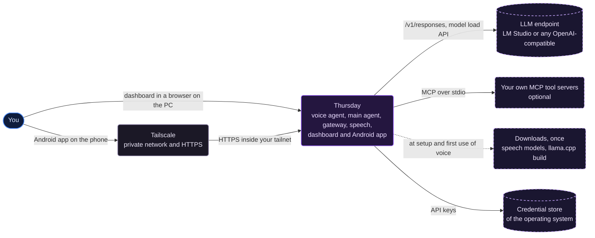

Everything Thursday needs at run time is on your PC, unless you point an agent at a cloud endpoint. The phone reaches it only through your own Tailscale network, the Android app keeps its own connection to the gateway, and no cloud push service is involved. Two things are downloaded once and run locally after that: the speech models (Whisper and Kokoro) the first time voice is used, and the llama.cpp build at setup. The built-in llama.cpp is part of Thursday (a process an agent starts), so it is not shown as an outside system. API keys are kept in the operating system's credential store, not in Thursday's files.

## Containers (C4 level 2)

This is the picture the root README shows.


Mermaid source

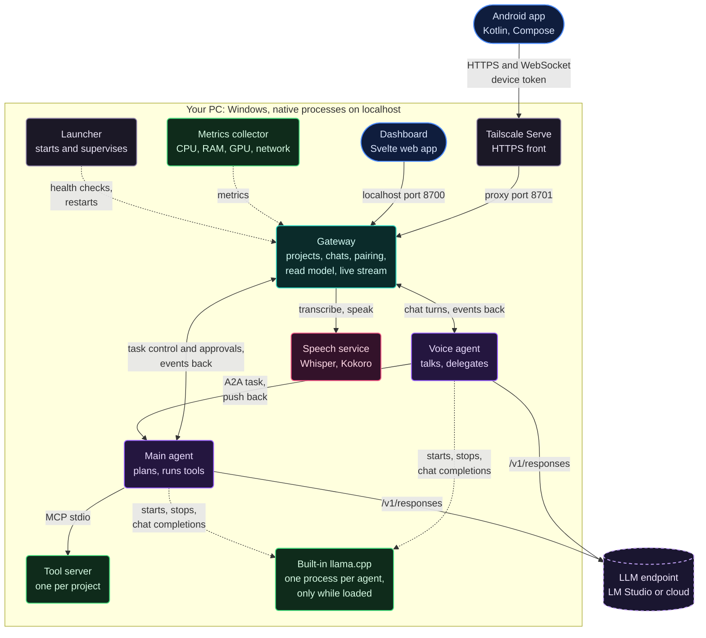

| Container | Responsibility | Owns |
|---|---|---|
| Dashboard | Presentation on the PC: chat with the voice field, trace, tools, monitor, settings | Nothing on the PC; per-browser preferences (theme, panel width, face animation, drafts) |
| Android app | Presentation on the phone, notifications with the phone locked, push-to-talk, optional app lock | Device token in the Android Keystore; per-phone preferences |
| Gateway | The single client-facing door: projects, chats, settings, pairing and devices, task control, event ingest, read model, notifications, read-only file views, speech relay, retention, backup orchestration. Serves the dashboard's files | Projects, chat list, devices (token hashes), non-secret settings, the read model (timeline, traces for the retention period, notifications, metrics history), the retention setting |
| Voice agent | Conversation, delegation, task-update relay, spoken approvals recognised in code | Voice transcripts per chat, its system prompt and versions, its LLM settings (provider, model, load and answer settings, context limit), its outbox |
| Main agent | Task execution: agent loop, step control, approvals, context, MCP client | Main transcripts and LangGraph checkpoints per chat, allow-always rules, task records and call-started marks, its system prompt and versions, its LLM settings (provider, model, load and answer settings, context limit), its outbox |
| Built-in llama.cpp | Serves one model to one agent over localhost. Started by that agent when the model is loaded, stopped on unload | Nothing; the model files are yours, in the folder you chose |
| Tool server | Runs tools, enforces workspace sandbox and permission policy | Its own SQLite call and audit log, one file per project; each call is recorded with the chat it was made for |
| Speech service | Speech to text (faster-whisper) and text to speech (Kokoro), on the CPU; turns a recording into WAV for a model that hears. Engines load on first use and are dropped after a while without use | The downloaded model files. No audio is stored |
| Metrics collector | Reads PC CPU, RAM, VRAM (per GPU), network; scrapes service `/metrics`; measures how much each service keeps on disk; pushes to the gateway | In-memory samples only |
| Launcher | Starts the services, checks their health, restarts a crashed one, stops them (`thursday up`, `down`, `status`), and stops a built-in llama.cpp server an agent left behind; `check` says what the PC is missing; `setup` makes `.env` and the service token and offers the built-in llama.cpp | A pid file and a stop file while running; the installed llama.cpp build |
| Tailscale Serve | Terminates HTTPS for tailnet traffic and forwards to the gateway proxy port | Certificates (managed by Tailscale) |

A client records audio and the gateway has it turned into text: by the voice agent's own model when that model can hear, otherwise by the speech service. The text is then sent as an ordinary chat message (see [FLOWS.md](FLOWS.md#voice-push-to-talk-and-read-aloud)).

### Events, logs, and metrics flow


Mermaid source

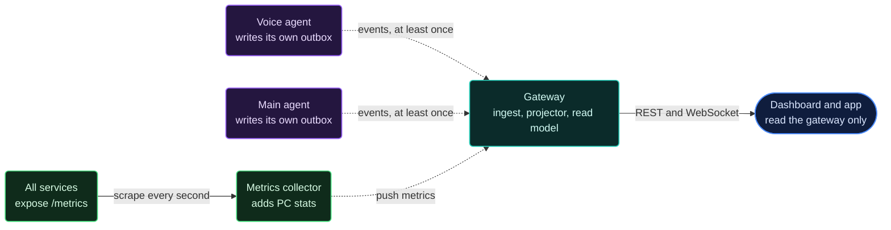

### Data rules

- Each service owns its data. No service reads another's tables. Clients read only the gateway.
- Agents write events to a local **outbox** and a background sender delivers them to the gateway at least once. The gateway deduplicates by `event_id` and keeps per-source ordering by `seq`. A service never waits on the gateway.
- The read model is a projection and can be rebuilt: each agent exposes a replay endpoint ("my events since N").
- Deleting a chat or project is an idempotent saga: the gateway stops the chat's running tasks, marks it deleting, asks each owning service to delete (repeatable), retries until all confirm, then removes its own records. Nothing about the chat is left in any database, the tool server's call log included; only the folder on disk is left alone. Marking a chat as deleting fails its messages that were still waiting to be sent, in the same step, and the relay sends nothing into a chat that is not active. Each agent keeps a short note that the chat was deleted (a week), so work that was already on its way cannot start or write anything for it afterwards.
- **Working data** is what was kept about how a task was done: the steps and traces in the gateway, the events an agent already delivered, a finished task's saved steps and protocol records, and the tool server's call log. One setting says how long it is kept (7 days to 1 year, or until you delete it; 30 days by default). The gateway owns the setting and sends it to each agent, which keeps its own copy and cleans its own data, so the clean-up is right even while the gateway is down; the main agent passes it to the tool servers it starts. Chats, messages, transcripts and the task list are not working data: they go only when the chat is deleted.
- A database that has grown mostly empty is compacted when its service starts (at least 8 MB with a quarter of it free), which is when deleted data actually leaves the disk.
- Every service keeps versioned forward-only migrations and takes a backup before migrating.

## Components (C4 level 3)

Each service uses the layers transport, application, domain, infrastructure. Dependencies point toward the domain; infrastructure implements interfaces defined by the application layer.

Those interfaces are the service's **ports**, in `application/ports.py`: each use case names the few operations it needs (for example "read and write a task record", "send a tool call"), and never the class that provides them. The database store, the HTTP clients and the MCP manager are **adapters** in `infrastructure` that happen to fit, and `bootstrap` is the only place that knows which adapter goes where. A use case can therefore be tested with a small fake, and an adapter can be replaced without touching it. `tests/test_layers.py` reads every import in every service and fails the test run when one points the wrong way.

### Main agent


Mermaid source

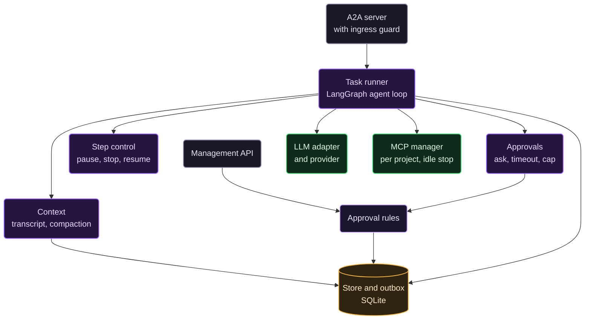

#### The agent loop


Mermaid source

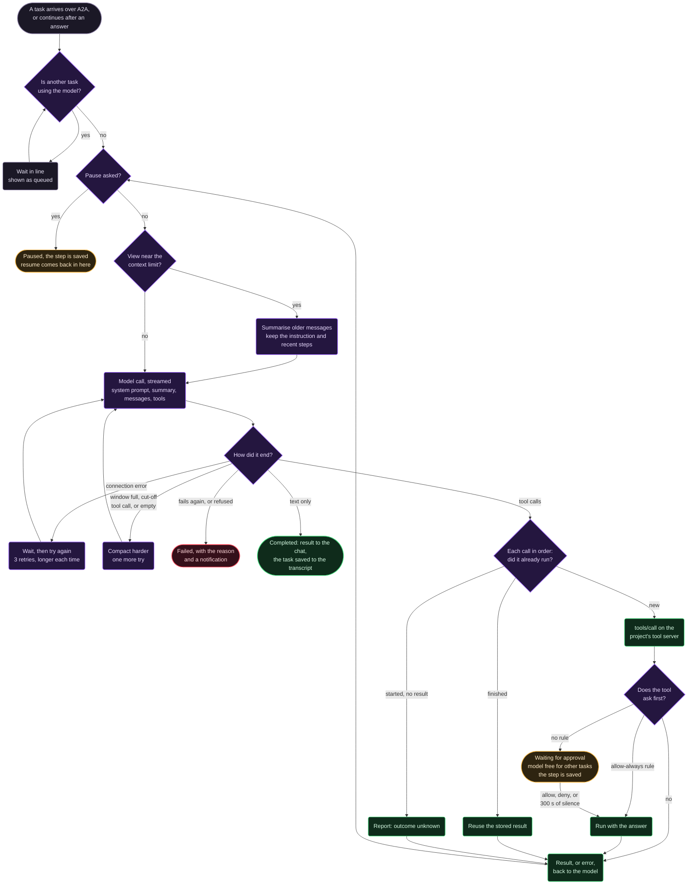

One pass through the loop is a **step**: one model call and the tool calls it asked for. Everything the loop knows is saved after every step (a LangGraph checkpoint per task), so a pause, an approval or a restart continues from the last step. A pause takes effect at the top of a step, never in the middle of one. A tool call carries a mark keyed by task, step and position, which is what makes it run at most once: a call that finished is answered from its stored result, and one that started without a result is reported to the model as "outcome unknown" instead of being run again.

Domain objects: task state machine, approval rule (scoped to a chat), chat context. The LLM adapter sits behind a **provider interface** with three providers, shared with the voice agent (see [LLM providers and settings](#llm-providers-and-settings)).

### Voice agent

| Layer | Components |
|---|---|
| Transport | Chat API (from gateway), A2A client with push-webhook receiver |
| Application | Conversation (LLM turns), Delegation (tasks, pause, stop, resume), Notifier (relays task updates into the chat), spoken-approval recognition in code |
| Domain | Chat context, delegated-task record |
| Infrastructure | LLM adapter with the same provider interface and settings, store and outbox (SQLite), metrics |


Mermaid source

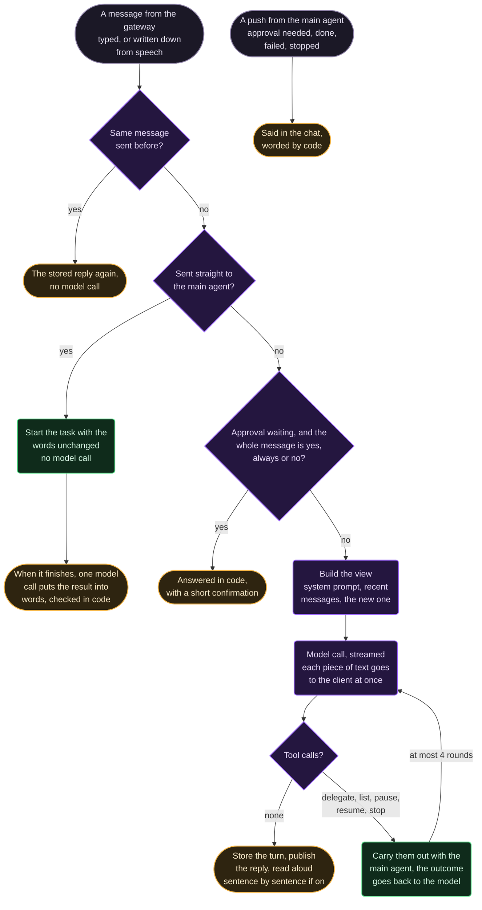

The voice agent's loop is a plain loop with no saved steps: a turn is short, and a turn that is repeated returns its stored reply. The model sees at most the last 60 messages (fewer when a context limit is set). That window starts at the same message for many turns and then moves forward 20 messages at once, because a model server reuses what it worked out for the unchanged start of a request; a window that slid by one message every turn would be worked out again from the top each time.

### LLM providers and settings

Both agents use the same package (`packages/llm`). Each agent holds one **LLM runtime**: its effective settings are the `.env` values, plus the changes saved from Settings (kept in the agent's own database), plus the API key read from the credential store. Changing a setting rebuilds the provider and the chat client; nothing is loaded by a change. A change and a model call never overlap: rebuilding closes the provider (for the built-in llama.cpp that stops its server), so a change asked for while the model is in use is refused and has to be asked again, and a call that starts while a change is being applied waits for it.

| Provider | Chat | Lists models | Loads and unloads | Key |
|---|---|---|---|---|
| LM Studio | `/v1/responses` | LM Studio's own list (a model downloaded in several variants is listed once) | Through LM Studio's native API, with the load settings; an already-loaded model is adopted | From the credential store |
| Built-in llama.cpp | `/v1/chat/completions` on the agent's own `llama-server` | The `.gguf` files under the chosen folder, with their sizes and whether a projector file sits beside them | Starts one `llama-server` process on a free localhost port with the load settings; unload stops the process, which frees the GPU | A random key made for each run; nothing is stored |
| OpenAI-compatible | `/v1/responses` | The endpoint's `/v1/models` | None: the endpoint decides | From the credential store |

- **Nothing loads at start.** A model is loaded by the Load button or by the first call that needs it.
- **Idle unload.** Each agent counts a model as in use for the whole of every call (loading included). A loop in the agent unloads a model that is loaded, not in use, and unused for the agent's idle time (five minutes by default, 0 for never): LM Studio through its unload API, the built-in llama.cpp by stopping its process. A cloud endpoint has nothing to unload. A task that waits for an approval longer than that simply loads the model again when it continues.
- **Graphics cards (built-in llama.cpp).** By default llama.cpp sees every card, puts as many layers on them as their free memory allows, and splits the layers between the cards; the rest runs on the CPU. Settings can limit it to one card, fix how many layers go on the cards, set each card's share, or fill the cards in order: the model goes on the chosen card, and only what does not fit there goes on the next. For that, before each load the agent asks llama.cpp's own tools, without loading anything, how much memory each card has free (`llama-server --list-devices`) and how much the model would use (`llama-fit-params`), works out each card's share (`packages/llm/gpu_plan.py`), and checks the plan with the same tool; if no plan fits, llama.cpp spreads the model as it sees fit. The cards then work one after the other (split by layer); llama.cpp's parallel split modes do not load on CUDA in the build setup installs.
- **Hearing.** A built-in llama.cpp model with an audio projector can write down a recording itself (`hear`): one short request with the recording alone and a system message that asks for the words only. The voice agent refuses clips over 30 seconds and results with more words than fit in the clip, so those go to speech-to-text.
- **Keys** are stored per agent and provider, so one provider's key is never sent to another. A key also belongs to the address it was typed for: when an agent's address changes, the key is held back until it is typed again. A key is written through Settings and is never returned; the settings only report whether one is set, or held back.
- **Load settings** (context length, batch size, flash attention, KV cache placement; for llama.cpp also the graphics cards, the layers on them, the split between them, and the number of expert layers kept in system memory) apply at the next load. **Answer settings** (temperature, top p, output token limit, and thinking on or off for llama.cpp or a reasoning effort for Responses endpoints) apply to the next call.
- **Context limit** (`compact_at_tokens`, per agent): the main agent summarises older turns when its view reaches this many tokens, never later than 90 percent of the loaded window. A cloud endpoint reports no window, so this limit is the only trigger there. The voice agent has no summariser: it sends the newest messages that fit in the limit, and the last 60 messages when none is set, moving the start of that window 20 messages at a time (see [Voice agent](#voice-agent)).
- **Checks that are asked often are answered from memory for a moment.** Whether a cloud endpoint can be reached is remembered for 30 seconds after a yes and 3 seconds after a no, and LM Studio's model list (which also answers "is it up" and "is the model loaded") for 2 seconds, so a chat turn, the status line and Monitor asking at the same time cost one request, not several. Loading or unloading a model forgets the remembered list at once.
- **What a trace stores.** A streamed response arrives as one event per token; the agent stores the response it carried (reasoning, answer, tool calls, token counts), not the stream, so it is readable and is not cut before the answer.

### Gateway


Mermaid source

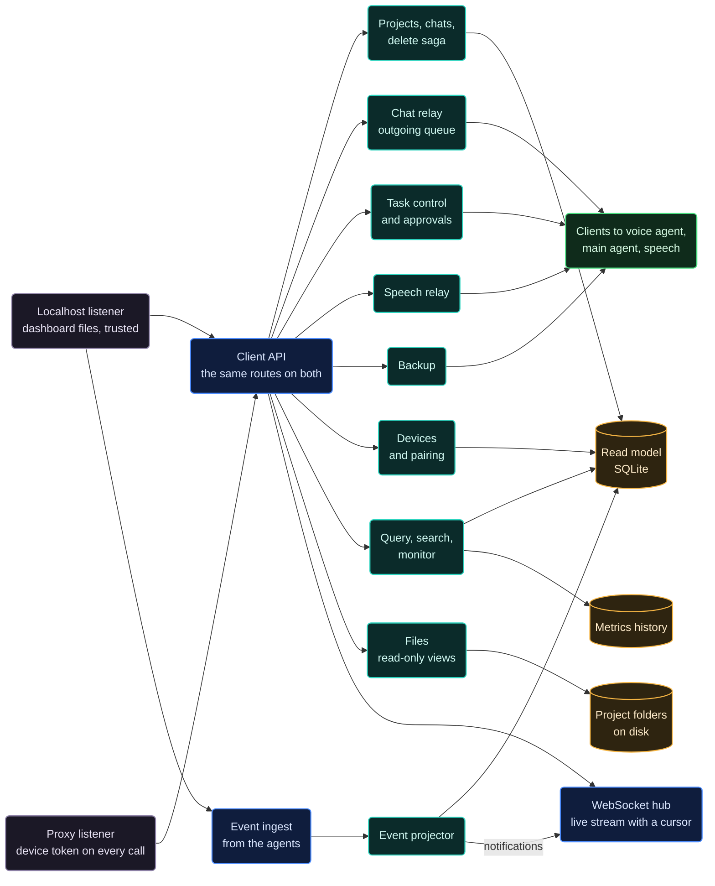

The gateway has **two listeners**: a localhost-only one for the dashboard on the PC (trusted, no pairing; it also serves the dashboard's files and accepts events from the agents) and one for Tailscale Serve that requires a device token on every call except claiming a pairing code. Pairing codes can only be made on the localhost listener. The projector raises the immediate plain approval notification from the event stream, independent of the voice agent.

### Tool server (built-in)

| Layer | Components |
|---|---|
| Transport | MCP stdio server |
| Application | Tool router, permission gate (asks through the MCP input-required result), session manager (shell session handles) |
| Domain | Policy (ask, allow, deny), workspace root and path rules |
| Infrastructure | File tools (read, write, edit, patch, delete), shell runner, SQLite audit and call log |

Tools in the first version: shell, shell session, `fs.read`, `fs.write`, `fs.edit`, `fs.patch`, `fs.delete`. The policy also holds a deny list: shell commands that are refused before the user is asked (see [SECURITY.md](SECURITY.md)). The owner's own MCP server can replace or join it behind the same MCP contract.

### Speech service

| Layer | Components |
|---|---|
| Transport | HTTP: `/v1/transcribe`, `/v1/decode`, `/v1/speak`, `/v1/voices`, `/v1/warm` (service token) |
| Application | Speech service: one request at a time per engine; text is cleaned of markdown and cut at a sentence before it is spoken; an engine unused for five minutes is dropped from memory, and `warm` loads the engines a turn is about to need while the user is still talking |
| Infrastructure | Whisper transcriber (faster-whisper, `small` by default, int8 on the CPU), Kokoro speaker (ONNX on the CPU, 54 voices); both load on first use; Kokoro's files download once into the service's data folder; the voice names are read from its file without loading it. A decoder (PyAV) turns webm, m4a, or wav into 16 kHz mono WAV with no speech model |

### Android app

| Layer | Packages |
|---|---|
| Presentation | `ui/*` (Compose): pair, chats, chat, projects and files, trace, tools, monitor, settings; `ui/chat/VoiceField` draws the voice field. A screen with rules of its own keeps them in a state holder that the screen only draws: `ui/settings/AgentPageState` holds the agent page's form, model list and actions, behind a small interface to the gateway, and is unit tested without a phone |
| Live | `live/`: one WebSocket with a cursor and backoff, the app's live state, a foreground service (type `remoteMessaging`) that keeps the connection so approvals notify with the phone locked, notifications |
| Domain | `domain/`: pure Kotlin with unit tests: timeline from events, grouping, chart series, markdown (with tables and the widths of their columns), the face cloud and the voice field's motion, and cutting a reply into pieces to read aloud |
| Data | `data/`: gateway REST client (OkHttp, calls off the main thread), models, pairing link, token store (Android Keystore) |
| Security and voice | `security/Guard`: phone credential or fingerprint before risky approvals and settings; `voice/VoiceIO`: push-to-talk recording and playback of spoken replies; `voice/SpeechQueue` plays the sentences in order and has the next one made while one plays |

The app's layout follows its window (`domain/WindowShape`, unit tested): its size, and how far the screen is turned from the way the device is held naturally. The navigation stays on the device's bottom edge: a bar along the bottom of the screen when the device is upright or upside down, a rail down the right after one quarter turn and down the left after three, with the destinations in the same places on the device. Along the bottom of a window under 600 dp wide it is put away inside a chat. At least 840 dp wide and 480 dp tall and a section's list sits beside what is opened from it (`ui/AppRoot`). The turn is read from the display as the system has it, again after every change the display reports and every change of the window's shape, and once more when the turn has settled: either can arrive first, and a turn from one side right round to the other changes no shape. Every device turns freely. Turning, resizing or folding redraws the screens without starting the app again, so the open chat, a half-filled form and a recording stay as they are.

### The voice field (dashboard and app)

The voice agent's presence in a chat is a field of particles behind the messages.

- **The line** is always there: a ribbon of particles that a mild breeze carries across the screen. In a chat the field covers everything down to the bottom of the message box, on two see-through layers: the face behind the messages, and the line over them, so messages show through the line as they scroll past. The message list reaches the bottom of the chat behind the status line and the message box, which is smoked glass (the page colour at 45% under its tint), so nothing in a chat has an opaque backing but the messages themselves. The chat tells the field where the status line is, and the line runs there (`fieldLayout` takes the distance from the bottom; without one the line rests on the bottom). With sound it pulses, low tones on the left and high tones on the right, taller when louder.
- **The face** gathers while the agent listens, thinks, or speaks, and is blown away on the breeze when it goes idle. It can be turned off (Settings, Appearance on the dashboard; Settings, Phone in the app); the line stays.
- The face is a cloud of about 20,000 particles in one binary file, `face-cloud.bin`, shipped with both clients (format in `apps/dashboard/src/lib/ui/facecloud.ts`). Each particle has a position in 3D, a brightness, how loose it is, and how much it moves with the jaw and lips, so the head can turn a little and the mouth can follow speech. The phone uses about half of the particles.
- The dashboard draws it with WebGL in one call (all movement is computed in the shader from a handful of numbers per frame); the app computes the same sums in Kotlin and draws batched points. The rules live in `fieldmotion.ts` and `FieldMotion.kt` and are unit tested.
- Sound comes from the microphone while listening and from the spoken reply while speaking (the dashboard analyses the real audio; the app uses the microphone's loudness and a speech-like pattern for replies).

## Technology choices

| Area | Choice | Reason |
|---|---|---|
| Model serving | LM Studio, the official llama.cpp `llama-server` started by Thursday, or any OpenAI-compatible endpoint, chosen per agent | LM Studio manages its own models; llama.cpp can be loaded and freed by Thursday itself and accepts audio; a cloud endpoint needs no hardware |
| API keys | The operating system's credential store through `keyring` | No key in a plain file; works the same on every operating system |
| Services | Python 3.12, FastAPI, Pydantic, `uv` workspace, SQLite per service | Project defaults; local single-node workload |
| Main agent runtime | LangChain `ChatOpenAI` plus LangGraph (checkpoints, `interrupt`) | Every step is saved, and a pause or an approval is an interrupt that survives a restart |
| Voice agent | Plain loop with the same LLM adapter | Low latency, no checkpoints needed |
| Agent protocol | A2A 1.0 via the `a2a-sdk` Python package | An open protocol for handing a task to another agent, with push notifications and extensions |
| Tools | MCP via the `mcp` Python SDK, stdio | An open protocol for tools, with a way to ask the user in the middle of a call |
| Speech | faster-whisper `small` and Kokoro (ONNX), both on the CPU | LM Studio's endpoint does not take audio; these run well on the CPU and leave the GPU to the models |
| Dashboard | Svelte 5, Vite, TypeScript; built to static files served by the gateway; WebGL for the voice field | Small bundle, no server of its own |
| Android | Kotlin, Jetpack Compose, OkHttp, CameraX and ML Kit for the pairing QR code | A native app keeps a connection and notifies with the phone locked |
| Phone connection | Tailscale Serve in front of the gateway's proxy port | HTTPS inside the tailnet only; nothing is exposed to the internet |

## Source layout and boundary map

One uv workspace with a single lockfile. Each folder is its own package with one responsibility. Services never import another service's package.

| Package | Folder | Owns | May depend on |
|---|---|---|---|
| `thursday-contracts` | `contracts/` | Published schemas only: event envelope, health reports, approval request and answer, task-control extension constants, problem details. JSON Schema snapshots in `contracts/schemas/` guard against accidental changes | pydantic |
| `thursday-runtime` | `packages/runtime/` | Shared technical plumbing: settings from `.env`, per-user data and log folders, JSON-lines logging with rotation, health and readiness routes, service-token auth, localhost serving, the event outbox (own SQLite file per service, publisher, sender with backoff, replay), per-service backup, and the secret store (API keys in the operating system's credential store) | contracts, FastAPI, uvicorn, pydantic-settings, httpx, keyring |
| `thursday-llm` | `packages/llm/` | Shared LLM provider layer: provider interface; LM Studio lifecycle (adopt a loaded model, else load with parameters; unload; reload); the built-in llama.cpp (one `llama-server` process per agent, started on load and stopped on unload); OpenAI-compatible provider; the per-agent runtime (settings from `.env` plus saved changes plus the key from a key store); chat model factory (Responses API, or chat completions for llama.cpp); raw body capture (bodies only); reading a streamed response back into the response it carried; stream timing | langchain-openai, httpx |
| `thursday-gateway` | `services/gateway/` | Projects, chats, outgoing message queue, read model (events, tasks, approvals, notifications, messages), relay to the voice agent, task control and approvals to the main agent, devices and pairing, read-only file views, speech relay, delete saga, dependency banners, WebSocket hub, metrics history; two listeners | contracts, runtime, a2a-sdk (types only), httpx |
| `thursday-voice-agent` | `services/voice_agent/` | Per-chat transcripts, delegated tasks and their push tokens, turn idempotency, prompt versions; conversation loop with task tools; spoken-approval recognition in code; push webhook | contracts, runtime, llm |
| `thursday-main-agent` | `services/main_agent/` | Tasks, approvals, allow-always rules, call marks, chat transcripts, prompt versions; LangGraph runner (one thread per task); A2A server with ingress guard; MCP manager; management API | contracts, runtime, llm, a2a-sdk, langgraph, mcp |
| `thursday-tool-server` | `services/tool_server/` | Workspace sandbox, permission policy, file tools, shell and shell sessions with process-tree kill, audit log (one SQLite file per project); MCP stdio server started by the main agent | runtime, mcp |
| `thursday-speech` | `services/speech/` | Local speech on the CPU: speech to text with faster-whisper (`small` by default) and text to speech with Kokoro (ONNX, 54 voices). Engines load on first use behind small interfaces; one request at a time per engine; no audio is stored. Kokoro's model files download once into the service's data folder | contracts, runtime, faster-whisper, kokoro-onnx, httpx |
| `thursday-metrics-collector` | `services/metrics_collector/` | Samples CPU, RAM, network (psutil) and per-GPU VRAM (NVML) every second, scrapes each service's `GET /metrics` (latency and queue loads), pushes to the gateway; memory only | contracts, runtime, psutil, nvidia-ml-py, httpx |
| `thursday-launcher` | `launcher/` | Starts the HTTP services as native processes, polls `/health`, restarts a crashed service after a capped exponential delay (1 s doubling to 30 s, reset after 60 s of stable running), adopts a service already running on its port, and stops services gracefully (CTRL_BREAK on Windows, then a forced kill); `down` stops a running supervisor from any terminal; `setup` generates the service token and, after asking, installs the built-in llama.cpp (the official build for this PC, each download checked against its published SHA-256, archives refused if they would write outside their folder); `check` reports what the PC is missing; before an agent starts and after `down`, a llama.cpp server recorded by an agent or run from Thursday's llama.cpp folder is stopped (never one run from anywhere else) | contracts, runtime, httpx, psutil |
| Dashboard (npm, not a uv package) | `apps/dashboard/` | The PC web UI: Svelte 5, Vite, TypeScript, built to static files the gateway serves on its localhost listener. `src/lib/api` (typed gateway calls, no state), `src/lib/live` (the one event-stream socket with cursor replay and backoff; visibility-aware polling), `src/lib/state` (app-wide state, one chat session, pure event-to-view functions, hash routes, per-browser preferences, voice input and output), `src/lib/ui` (shared components, the markdown renderer, and the voice field), `src/features/*` (one folder per screen: shell, chat, projects, trace, tools, monitor, settings). No scrollbars are drawn; every scrolling area still scrolls | gateway REST and WebSocket only |
| Android app (Gradle, not a uv package) | `apps/android/` | The phone UI: Kotlin and Compose, packages `ui`, `live`, `domain`, `data`, `security`, `voice` as in the table above. Release builds are signed with a key kept outside the repository | gateway REST and WebSocket only |

Inside a service, dependencies point inward: `transport` and `infrastructure` depend on `application`, which depends on `domain`; only `bootstrap` wires concrete adapters. `application` reaches a database, another service or a tool server only through the interfaces in its own `ports.py`. The rule is checked by `tests/test_layers.py` on every test run.

The metrics collector samples every second (`METRICS_SAMPLE_INTERVAL_SECONDS`); the gateway streams every sample on `/v1/metrics/stream` only while a Monitor screen holds it open, and stores history at most every 5 seconds for 24 hours and one sample per minute for the retention period. Backups: the gateway asks each service to copy its own SQLite files (SQLite online backup) into one timestamped folder with a manifest, keeps the newest N copies, and never includes `.env` or API keys. Keep-awake: the main agent holds a Windows power request while a task runs or waits for approval, and for a limited time while paused. Compaction: at the agent's context limit, and never later than 90 percent of the loaded window, the main agent summarises older turns with the same model; the model then sees the summary, the current instruction word for word, and the recent steps. A summary that is tool-call syntax or too short is rejected and asked for again with "write notes, do not call tools"; if the model still cannot, plain notes are built from the messages without it. The summary is shown to the model only; the transcript below is never rewritten.

Retention and stored data: the gateway keeps the retention setting (`data_retention_days`, 0 for "until I delete it") and removes its own stored events older than that once an hour; it sends the period to both agents (`PUT /v1/retention`) when it changes and again until each has confirmed it. The main agent then removes, for tasks that ended before the cut-off, the saved steps, the task protocol's records, the run-once marks and the answered approvals, and from its outbox the events already delivered; the voice agent removes delivered events and old turn records. The main agent starts each tool server with the period (`--keep-days`), and the tool server prunes its own call log. Every tool call carries the chat it belongs to as call metadata the model never sees, so deleting a chat also removes that chat's calls from the log (the main agent runs the tool server's own `forget-chat` command; a tool server owns its files). The metrics collector measures the databases and logs of each service about once a minute, and Monitor shows them per service with the total.

Dashboard: the gateway's localhost listener serves `apps/dashboard/dist` and guards browser traffic (Host must be the listener's own address; any Origin must be its own; writes need the `X-Thursday-Client` header; a CSP on pages), which blocks cross-site requests and DNS rebinding. The dashboard opens one event-stream socket, joins it at `stream_pos` from `/v1/status`, and merges stored and live data by event position. Chat state (messages, task cards, approvals, streamed replies) lives in one chat session at a time; other screens poll only while visible, and Monitor holds the metrics socket only while it is on screen. Pairing: the gateway makes one-time codes on the localhost listener only, stores device tokens hashed, rate limits claims, and closes a revoked device's sockets at once.

Direct mode: the gateway decides when it accepts a message whether the chat sends through the voice agent or straight to the main agent (the chat's switch is a gateway record). A direct message takes the same queue, ordering and retry path, but is delivered to the voice agent's `/v1/chats/{id}/direct` endpoint, which starts the task with the user's words unchanged and records the exchange in the voice transcript as if it had delegated; no voice model call is made. The voice agent keeps owning the task record and the push webhook, which is why the path goes through it. When the task finishes, a finished direct task with a result is reported by the voice model in the background, shown the exchange with the result as the tool's answer and offered no tools; the reply is checked in code (`domain/reports.py`) and replaced by the main agent's own words if it is empty, is tool-call syntax, claims work is only being delegated, or the model cannot be reached. Failed and stopped tasks are announced by code.

Main agent execution: each task runs on its own LangGraph thread seeded from the chat transcript. Tasks take turns on the model (one at a time, the rest queued), because all of them would otherwise share one context window; a task waiting for an approval has let go of its turn. A finished task is appended to the transcript compactly: its instruction, a tool log (each call with its arguments in short form and how it ended, repeated calls marked), and its final message; raw tool output stays in the task trace. A summary written during a task is saved for the chat when the task ends, as covering the history that came before it (the task's own record follows in full), so the next task starts from it. Model errors, including ones that arrive mid-stream, are caught: a full window, a cut-off tool call or an empty reply is retried once after compacting harder, anything else fails the task with a clear message and a notification, and no error leaves a task in the working state. The A2A executor returns on an approval (`INPUT_REQUIRED`) or a pause (`WORKING`, paused); the next message resumes from the checkpoint. Approval timeouts, resume after pause, and restart recovery re-enter through the SDK with an in-process message that remote callers cannot send.

## Runtime and delivery

- **Native processes** on a Windows PC, started by the **launcher** (`uv run thursday up`), which checks health and restarts crashed services with a delay; `uv run thursday down` stops them. No Docker for the harness because the tool server and metrics need the host filesystem, shell, and GPU. LM Studio and Tailscale run beside it as separate applications. Day-to-day running, updating, and backups are in [OPERATIONS.md](OPERATIONS.md).
- Ports, all on localhost: gateway 8700 (dashboard and trusted API) and 8701 (proxy listener for Tailscale Serve), voice agent 8710, main agent 8711, metrics collector 8720, speech 8730. Each built-in `llama-server` takes a free port when its model is loaded.
- **Cold start and idle:** starting Thursday loads nothing. Models load on the Load button or on first use, the speech engines on first use of voice. Unload frees the hardware while the services keep running, and models and speech engines unused for five minutes are unloaded by themselves. Pressing the microphone tells the PC to start loading what the spoken turn will need (the voice model, and the speech engines in use), so a turn after a break does not wait for a load once you stop talking; a typed message sent while replies are read aloud starts loading the voice the same way.
- Every service has its own health and readiness checks and keeps running when another is down. The gateway shows banners for down dependencies, from the second missed readiness check in a row (one miss can be a busy moment, or a check that landed on a closed connection, which is asked again at once); Monitor shows service state and restart counts.
- Every service keeps an unused connection open for 30 seconds (`thursday_runtime.serve`), longer than the five seconds its callers keep one. With both at five seconds, a caller that asks every five seconds reuses a connection in the moment the service closes it: measured, 6 of 40 readiness checks against a stand-in service failed that way and none of 40 with 30 seconds, and 2 of 60 failed against the running voice agent, each one a false "not running" banner.
- Structured logs per service outside the repository, with rotation, carrying chat, task, and event IDs.
- The PC is kept awake while a task is running or waiting for approval (a paused task holds it for up to 30 minutes by default); this cannot stop a manual sleep or lid close.
- The repository is a monorepo: a folder per service, the dashboard, the Android app, and a small contracts package that contains only stable schemas.
- Releases: the dashboard is built to static files; the Android app is a signed APK built locally (`./gradlew :app:assembleRelease`) that can be copied to any phone on the tailnet. The signing key and its password stay outside the repository.

## Reliability and freshness requirements

- Live timeline and notifications reach clients within a few seconds under normal load; clients reconnect with a cursor and replay missed events.
- Visible screens refresh; hidden screens do not poll. Monitor data is pushed to a client only while Monitor is visible.
- Services time out and bounded-retry every cross-service call; each important interaction defines idempotency (see [CONTRACTS.md](CONTRACTS.md)).
