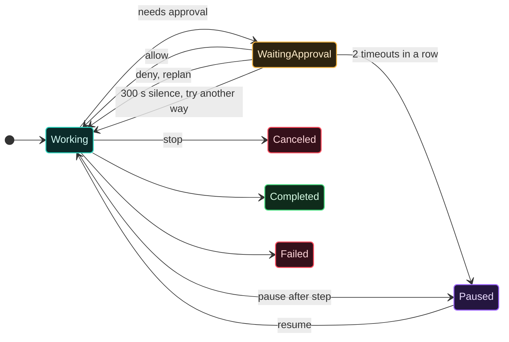

# What you see and do

This page describes Thursday from the side of the person who uses it: the screens, what each action does, and what happens when something fails. [ARCHITECTURE.md](ARCHITECTURE.md) describes how the parts work. The [architecture model](architecture/index.html) has each journey in full.

## Screens

The dashboard has a side panel, and the app has a bottom bar. Both lead to the same five screens.

| Screen | What it shows |
|---|---|
| Chats | Projects, each with its chats. A chat shows messages, a task card for each delegated task, approval cards, the voice field and a status line |
| Trace | Each task with its steps: every model call with its request and response, every tool call, the approvals and the result. **Raw** shows the body as stored |
| Tools | The tool server of each project, and the allow-always rules of each chat. A rule can be revoked |
| Monitor | CPU, RAM, VRAM for each GPU, network, tokens per second and time to first token for each agent, latency for each service, queues, service state, and the data each service keeps. History goes back 7 days |
| Settings | For each agent: the provider, the model, the API key, load and answer settings, a context limit, Load, Unload and Reload. Also prompts and their versions, devices, backup, keep-awake, retention and appearance |

- **The status line** gives each agent's tokens per second and the context in use, for example `Voice 107 tok/s · 1275/8192`. A cloud endpoint is marked, because it sends data off the PC.
- **A task card** has a status dot: orange while the task runs or waits, green when done, red when failed or stopped. A tool call shows the moment the main agent asks for it, with a purple dot that turns green, red, or orange (outcome unknown).
- **The voice field** is a field of particles behind the messages. A line drifts along the status line and pulses with sound. A face gathers while the voice agent listens, thinks or speaks. The face can be turned off; the line stays.
- **On the phone**, Settings is one list. A page that changes something on the PC asks for the fingerprint or PIN once, when you press **Save**.
- **On a tablet lying down**, a list and the item opened from it show side by side. Turning the device only redraws the screen. The open chat and anything half typed stay.

## First run and pairing

1. Run `uv run thursday up`. The dashboard on the PC needs no pairing.
2. In Settings, choose a provider and a model for each agent. Type an API key if the endpoint needs one.
3. Run `tailscale serve --bg http://127.0.0.1:8701` once, so the phone can reach the PC.
4. In Settings, Devices, make a pairing code. The code works once, for five minutes, and shows as a QR code.
5. Scan the QR code with the app. The phone keeps its device token in the Android Keystore.

A paired device can be revoked in Settings. A revoked phone disconnects at once and shows that it was removed.

## Sending a message

You type a message, or press the microphone and speak. The voice agent answers. When the message asks for work, the voice agent gives a task to the main agent and goes back to the conversation. You can keep talking while the task runs.

- **Queued, delivered, failed.** Each message shows its state. A chat holds up to 100 waiting messages; the next one is refused, and the client may send it again after 30 seconds.
- **Repeats are safe.** A message sent twice with the same id is answered once.
- **Direct mode.** The **Direct** switch beside Send sends your words to the main agent unchanged, without the voice model. Direct messages are labelled "You · direct". When the task ends, the voice agent reports the result in one or two sentences. Code checks those sentences, and uses the main agent's own words if they are empty or wrong.

## Approvals

A risky tool call (a shell command or a delete in the built-in tool server) asks you first. An approval card shows in the chat, with a notification on the phone, also with the phone locked.

Mermaid source

- **Allow once** runs the call. **Allow always** also writes a rule for that tool in that chat only. **Deny** tells the model to find another way.
- A plain "yes", "always" or "no" in the chat, typed or spoken, answers a waiting approval.
- The first answer wins. A later answer gets "already resolved".
- With no answer in 300 seconds, the request is cancelled and the model is told that you did not respond. Two of these in a row pause the task.
- A shell command on the deny list is refused at once, and you are not asked.

## Task control

- **Pause** takes effect when the current step ends. A step is one model call and the tool calls it asked for.
- **Resume** continues from the saved step.
- **Stop** ends the task at once, and kills a running shell command.
- You can also ask the voice agent to pause, resume or stop a task.
- To change a running task, stop it and send a new instruction in the same chat.

## Voice

1. Press the microphone. The PC starts to load what the spoken turn needs.
2. Speak, then release. A model that can hear writes down your words. Otherwise Whisper does it on the CPU.
3. The words go to the chat as a normal message.
4. If the speaker button is on, the reply is read aloud, one piece at a time, while it is written.

Thursday stores no audio. Continuous listening is not built. A clip over 30 seconds always goes to Whisper. On the test PC, a first piece of 31 characters took 0.4 seconds to speak, and a reply of about 400 characters took 5 seconds.

## Models

- **Nothing loads until asked.** Press **Load**, or send a message: the chat shows "loading model".
- **Idle models unload.** A model that nobody used for the agent's idle time (five minutes by default) unloads by itself. The next message loads it again.
- **Each provider keeps its own model, address and key.** A key is typed once and never shown again.
- **A setting saved while the model answers** is refused with "The model is in use right now. Try again when it has finished."
- **A model that cannot load** shows the reason from the engine. The settings stay as saved.

## When something fails

| What fails | What you see |
|---|---|
| The model server is down | A banner. Messages queue. A running task tries the call three times, then fails with a notification |
| The model's window is full, or the reply is cut off or empty | The call is tried once more with a shorter context. If it fails again, the task fails with a message that says what to change |
| The voice agent stops in the middle of a turn | The gateway sends the message again when the voice agent is back. The chat shows the message once and one answer |
| The main agent restarts during a task | The task continues from the last saved step. A tool call that started with no result is reported as "outcome unknown", not run again |
| The gateway is down | The agents keep working. Their events wait and arrive later. Clients cannot connect |
| A service crashes | The launcher restarts it. Monitor shows the restart count |
| The phone leaves the tailnet | The app shows "PC unreachable". When it connects again, it receives what it missed |
| The phone cannot look up the PC's name | The app says to set Private DNS to automatic or off |
| The speech service is down | The microphone and speaker buttons say so. Typing still works |
| A chat is deleted while a message waits | The message fails with "The chat was deleted." Nothing more is written for the chat |
| An API key is wrong or missing | The task fails with the endpoint's refusal |

## Data

- Chats and their messages stay until you delete them. A delete asks first, and removes the chat from every service, the tool call log included.
- Working data (traces, saved task steps, tool call logs) goes after the period you choose in Settings, General: 7 days to 1 year, or until you delete it. The default is 30 days.
- **Back up now** in Settings copies every service's data into one folder. A daily backup is optional.
- Hidden screens do not poll. A client that comes back receives the events it missed.
