# Major Flows and User Experience

Each picture is rendered from the Mermaid text folded under it.

## Navigation and screens


Mermaid source

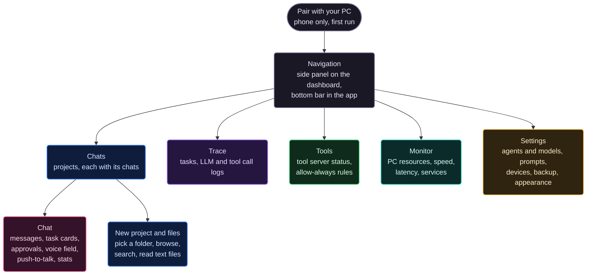

- **Chat** shows messages and, for each delegated task, a task card: a status dot (green done, red failed or stopped, orange running or waiting), the instruction, and a small arrow that opens its steps (LLM calls, tool calls, approvals, the result). Approvals appear as cards in the chat with allow once, allow always, and deny. Agent text is rendered as markdown: headings, lists (a numbered list that carries on after something else keeps its numbers), code, and tables, which fit the message's width and scroll sideways inside their own box when they cannot. One status line rests on the message box, on the particle line. Nothing there has a backing of its own: messages scroll on behind the particle line, the status line and the message box, down to the bottom of the chat, and show through all three (the message box is smoked glass, which dims what passes behind it so that what is typed stays easy to read). The status line gives, for each agent, tokens per second and the context in use out of the window, as in `Voice 107 tok/s · 1275/8192 · Main 74 tok/s · 4374/65536`. A value the endpoint does not report is left out, and a cloud endpoint is marked as sending data off the PC. Every message, task result and code block has a copy button. The voice field sits behind the messages (see below).
- **Steps appear as they start.** In a task card each tool call shows the moment the main agent requests it, with a purple pulsing dot and “Working…” under it; the dot turns green when the call worked, red when it failed, and orange when its outcome is unknown. A call that never reported back before the task ended reads “did not finish”.
- **Trace** holds the full detail for a task, kept for the retention period (30 days unless changed). The task list can be grouped by chat or by project and shown newest or oldest first. A task's steps can be shown first to last or last to first; last to first puts the result on top and reverses the tool calls inside each step as well. Both choices are remembered on that device. On a wide dashboard the task list scrolls by itself beside the trace; in a narrow window the list and the trace take turns, with **All tasks** to go back to the list where it was left. Each model call shows its request and its response as labelled parts in order (system, user, assistant, thinking, tool call, tool result, then settings and token counts); **Raw** shows the body exactly as stored. On the phone long parts start folded. In the app the list's three choices (what to show, how to group, which order) sit together in one panel above the tasks, each group is headed by its name and how many tasks it holds, and a task opens with its state, where it ran, the instruction and four figures (total time, model calls, tool calls, tokens), then its numbered steps and the result.
- **Tools** shows the tool server of each project and a chat's allow-always rules, which can be revoked.
- **Monitor** shows CPU, RAM, VRAM per GPU, network, for each agent its tokens per second (over the whole time the model produced tokens, thinking included) and its time to first token (from sending the request to the first text or tool call back, so a model that thinks first shows a longer wait; one dot per call; loading the model is not counted), latency per service, queue loads, and service state, live every second, with history ranges from 15 minutes to 7 days; and how much data each service keeps on disk, with the total.
- **Settings**: for each agent the provider, the address or models folder, the model picked from the provider's list, an API key box (write only: it shows whether a key is stored, never the key), load settings, answer settings, a context limit in steps of 1024 tokens, and Load, Unload, and Reload (see [Model settings and loading](#model-settings-and-loading)). Also system prompts (read, edit, save, version history), paired devices with pairing and revoke (dashboard), backup, keep-awake, how long working data is kept (7 days, 30 days, 3 months, 6 months, 1 year, or until you delete it), theme, the face animation switch, and how see-through the messages are over the face (solid by default).
- **Settings on the phone** are laid out like the phone's own settings: one scrolling list (App, Pairing, Main agent, Voice agent, Prompts, Devices, Backup, General), each row showing how it is set now and opening one page with all of its settings. Pages that change something on the PC have **Save** at the top right, which asks for the fingerprint or PIN once; the App page (theme, face animation, message transparency, stay connected, app lock, fingerprint before allowing) applies at once.
- **Layout on a phone and a tablet** follows the size of the window, and turning the device only redraws it: the open screen and anything half typed stay.
  - The navigation stays on the edge of the device where it is when the device is held upright: its bottom edge, the way a camera's controls stay where they are. Turned on its side, that edge is the right or the left of the screen; the navigation runs down that side with every destination in the place it has on the device, and only the icons and their names turn to stay upright. Held upside down, it is along the bottom of the screen again.
  - Along the bottom of a phone's screen the navigation is put away inside a chat, so the chat has the room; the Back arrow returns to the list, where the bar is. Down the side, and on a tablet, it stays.
  - A tablet lying down shows a list and what is opened from it side by side: the chats beside the open chat, the tasks beside a task's trace, the settings beside the chosen page. What is open is marked in the list. A phone lying down is wide enough for that but not tall enough, so it keeps one pane.
  - A message is nearly as wide as a phone's screen, and about three quarters of a wider pane, up to a comfortable line of text.
  - While the keyboard is open the bar along the bottom is put away, so it does not sit on top of the keyboard.
  - Monitor puts its tiles and panels two to a row where the pane is at least 600 dp wide (a tablet either way up, a phone on its side): each agent's tokens per second beside its time to first token, the services beside what is waiting, and the gauge beside the headline. One left over takes the whole row. A phone held upright keeps one to a row.
- Neither client draws scrollbars; lists and pages scroll by touch, wheel, and keys.
- **Projects and files (phone and dashboard)**: a project is a folder on the PC. The phone can make a project by browsing the PC's folders, and can browse, search, and read text files inside a project.

## First run and pairing

1. `uv run thursday up` starts the services. The dashboard on the PC is trusted through the localhost listener.
2. In Settings choose a provider for each agent, give its address or models folder, save, and pick the model from the list; type the API key if the endpoint needs one. Nothing is loaded yet: press Load, or let the first message load it.
3. Publish the gateway's proxy port inside the tailnet once: `tailscale serve --bg http://127.0.0.1:8701`.
4. In Settings, Devices the dashboard makes a single-use pairing code, valid five minutes, and shows it as text and as a QR code holding the PC's tailnet address and the code.
5. The phone scans the QR code (or the address and code are typed) and sends the code plus a device name to the gateway. The gateway burns the code and returns a long-lived device token, which the phone stores in the Android Keystore.
6. Paired devices are listed in Settings and can be revoked; a revoked phone is disconnected at once and shows that it was removed.

## Main flow: instruction with an approval

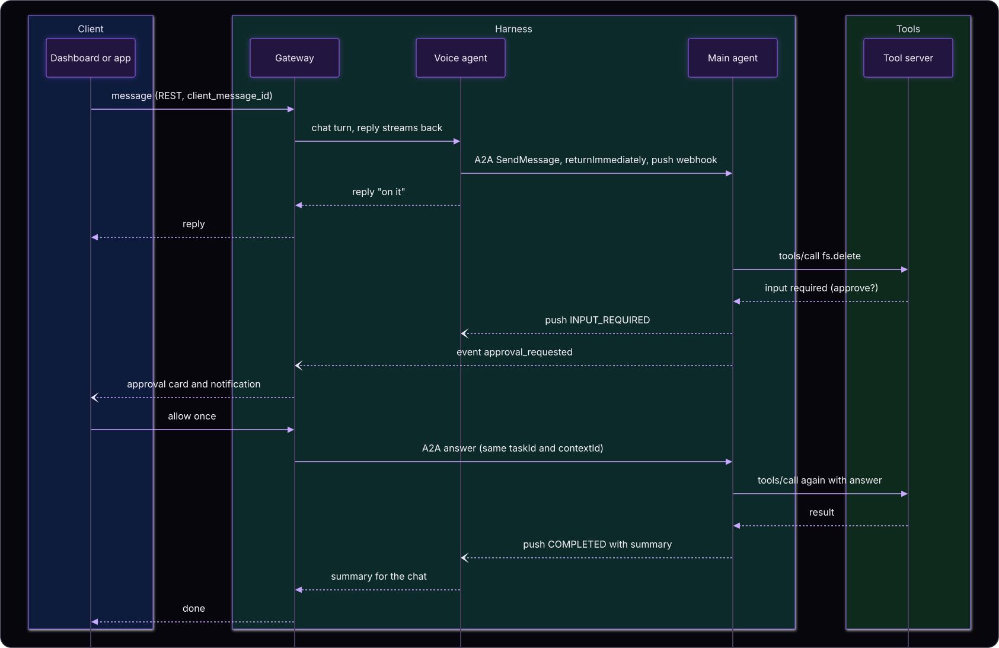

Mermaid source

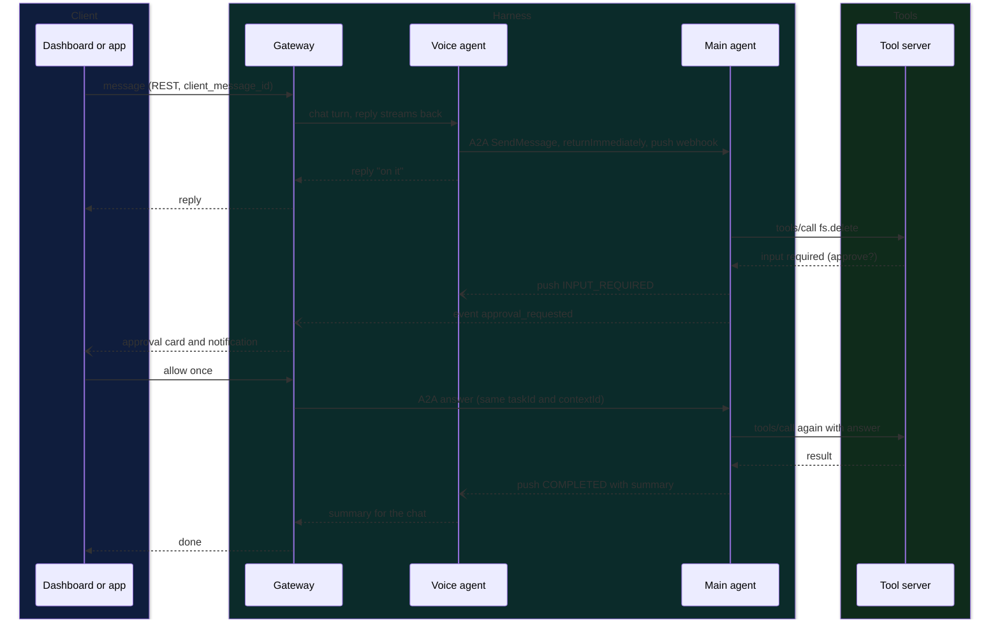

Approval answers come from the gateway (a button in a client) or from the voice agent (a spoken or typed yes or no, recognised in code while an approval is pending). The first answer wins; a later one receives an "already resolved" error.

## Voice: push-to-talk and read aloud

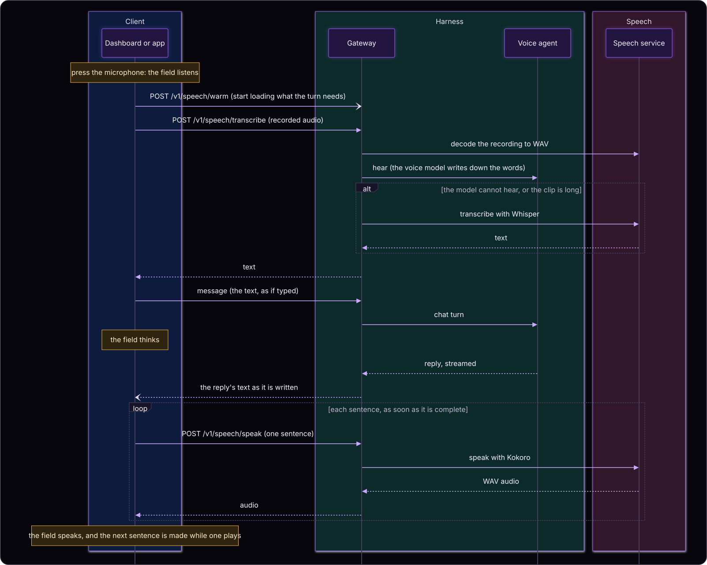

Mermaid source

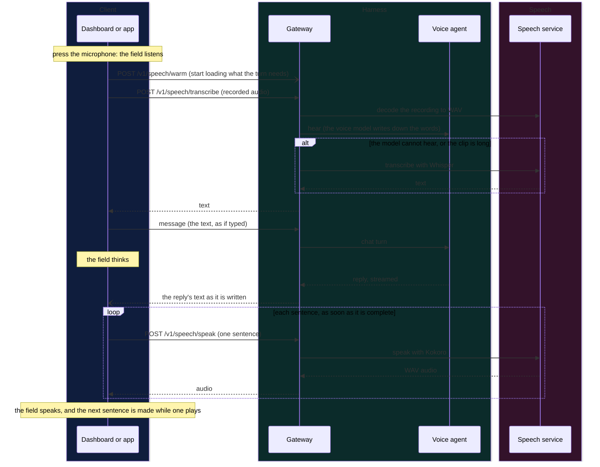

Speech is a thin layer around the normal chat: the transcribed text is sent as an ordinary message, so delegation, spoken approvals, and the timeline work exactly as with typing. Who writes the words down depends on the voice agent's model: a built-in llama.cpp model that can hear does it itself, in a fraction of a second on the GPU; any other model, a clip over 30 seconds, or a result that does not fit the clip goes to Whisper on the CPU. Either way the model then answers the text, in a second call. Replies are read aloud only when the speaker button is on. No audio is stored anywhere. Continuous listening is not built.

A reply is read **in pieces**. The client cuts the text as it arrives (a short piece such as "Okay." joins the next one; a list number or an abbreviation does not end a sentence; a line with nothing to say, such as a rule or a code fence, is skipped), asks for the audio of each piece, and plays them in order, with the next one being made while one plays. The first piece of a reply may end at a comma, so the voice starts on a short clause; after that the pieces are whole sentences, which sound better. Tapping the microphone or turning the speaker off stops the voice and drops what was waiting.

How long the voice takes to start is set by the first piece, because making audio takes about a fifth of the time the audio lasts. Measured through the running system on the test PC with the voice loaded: a clause of 31 characters took 0.4 seconds, a sentence of 62 characters 0.9, one of 118 characters 1.3, and a whole reply of about 400 characters 5 seconds. A voice that had been dropped from memory adds about 1.3 seconds to the first piece. Two things keep that out of the way: pressing the microphone tells the PC to load whatever the spoken turn will need, and sending a typed message while replies are read aloud tells it to load the voice (`POST /v1/speech/warm`), in both cases while the reply is still being written. Using more or fewer processor threads for the voice made no reliable difference.

### The voice field

- **The line** is always there, running along the status line just above the message box: particles carried across the screen by a mild breeze. It is drawn over the messages and is see-through, so a message scrolling past shows behind it; the message box, smoked glass, dims the half of the line that runs behind it. While you talk or the agent speaks it pulses with the sound, low tones on the left and high on the right, taller when louder.
- **The face** gathers out of the breeze while the agent listens (greens and blues, leaning toward you), thinks (blue, violet, and magenta, looking slowly from side to side), or speaks (cyan through pink to orange, lips and jaw moving with the words). When the agent goes idle the face is blown away.
- The face can be switched off in Settings; the line stays. People who turn off animations in their system get still frames.

## Direct mode: straight to the main agent

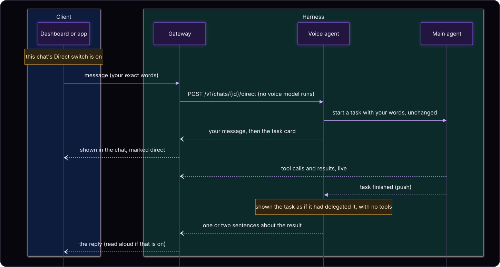

Mermaid source

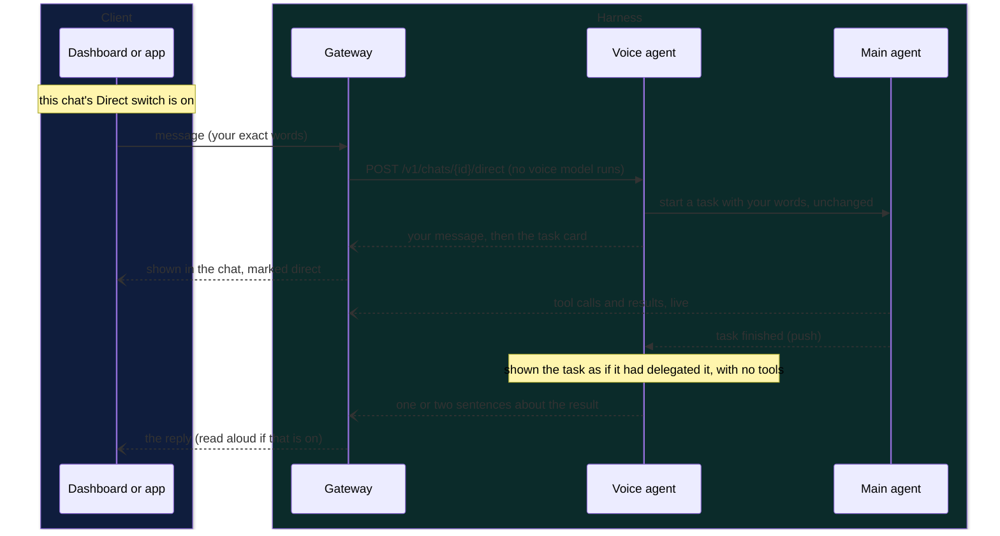

A chat can send everything straight to the main agent, skipping the voice agent. The switch belongs to the chat and is kept on the PC, so the dashboard and the phone always agree. Turn it on with the **Direct** pill beside Send, or with a right-click on Send in the dashboard or a long-press on Send in the app; both open the same two choices, “Send to the voice agent” and “Send straight to the main agent”. Direct messages are labelled “You · direct”.

- **Your words are not reworded.** The task starts with exactly what you typed. No voice model call is made to send it, so it also works while the voice model is busy or down.
- **The reply.** When the task finishes, the voice agent is shown it as if it had delegated it itself, with the result as the tool's answer, and asked for one or two sentences. It is given no tools, so it can only report. The voice agent's transcript also holds the exchange, so “what did you just do?” has something to go on.
- **Code checks the words.** An empty reply, tool-call syntax, a claim that work is only being delegated or is in progress, or an over-long reply is dropped, and the chat shows the main agent's own words (“Done. …”) instead. A task that failed or was stopped is announced by code, not by the model, and so is any result when the voice model cannot be reached.
- **Approvals still work.** While an approval is waiting, a plain “yes”, “always” or “no” answers it, as in a normal chat. Tasks wait their turn on the model like any other, so a second direct message queues behind the first.
- **Failure.** If the main agent cannot be reached the message stays queued and is retried; if it refuses the task the message fails and says why.

## Model settings and loading

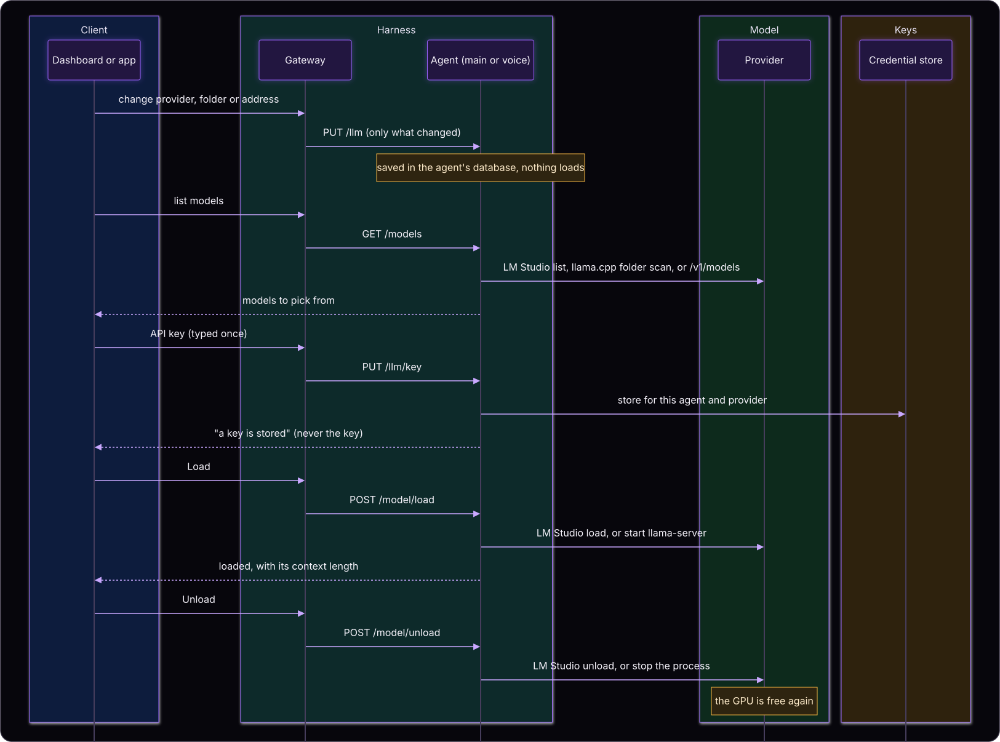

Mermaid source

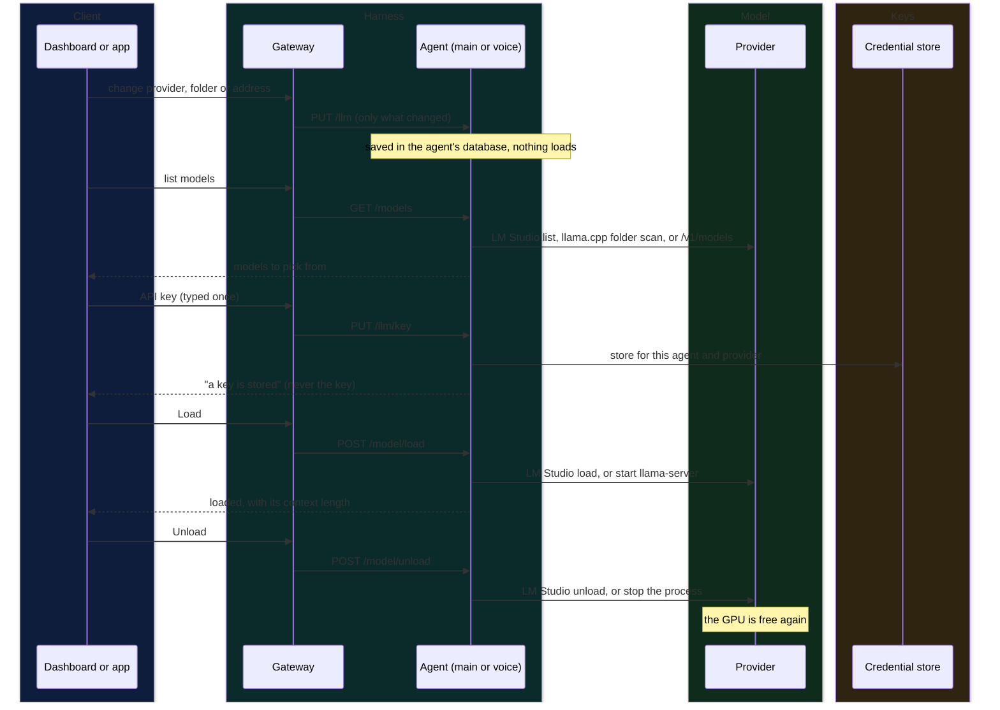

- **Nothing loads until asked.** Starting Thursday loads no model. Load does it on request; otherwise the first message that needs the model loads it, and the chat shows "loading model".
- **One card first.** With the built-in llama.cpp on a PC with several graphics cards, "A model larger than one card" chooses between spreading a model over the cards and filling one card first. Filling first keeps the other card free for a second model that fits one card. The page says how the loaded model was placed.
- **Idle models are unloaded.** A model nobody has used for the agent's idle time (five minutes unless changed, Never to keep it) is unloaded, on LM Studio and on the built-in llama.cpp alike. It is never unloaded in the middle of a call. The next message loads it again.
- **Each provider keeps its own model and address.** Switching provider shows what that provider used last, or an empty choice, never the other provider's model. When the provider's list holds exactly one model and none is chosen, it is chosen for you and shows as an unsaved change. Load and Reload stay off until a model that provider can load is chosen.
- **The model list belongs to what is saved.** After changing the provider, the address, or the models folder, the screen says "Save to see the models this provider offers".
- **Every setting is a list** of the values that provider accepts, with its default named first, for example "Default (8192)". The context length never offers more than the chosen model allows.
- **Keys.** A key is typed once and stored for that agent and provider. On the dashboard Save key stores it at once; on the phone it is stored with Save. Changing the provider first asks you to save, because each provider keeps its own key.
- **Built-in llama.cpp.** If setup has not installed it, the page says to run `uv run thursday setup`. A projector file beside the model is noted ("this model can take images and, if it supports it, speech").
- **Failure.** A model that cannot load reports the reason from the engine (LM Studio's message, or the last lines of the llama.cpp log); the settings stay as saved.

## Task control

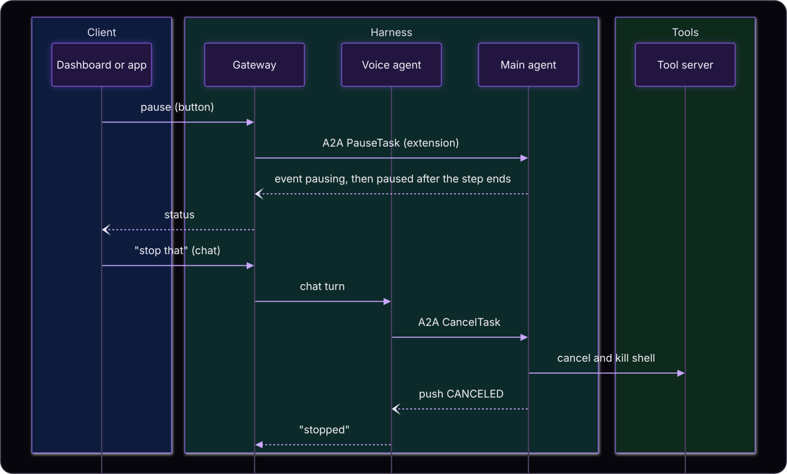

Mermaid source

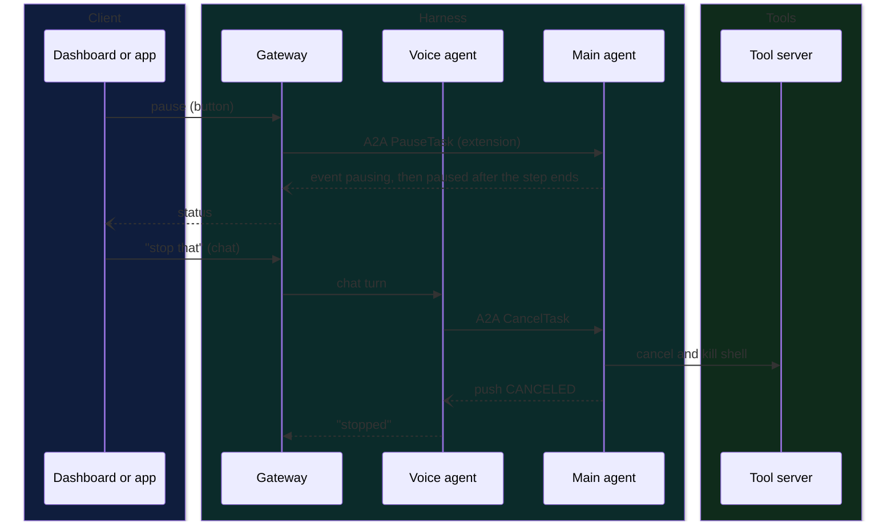

A stop button goes directly from the gateway to the main agent. To amend a running task the user stops it and sends a new instruction in the same context.

## Approval states

Mermaid source

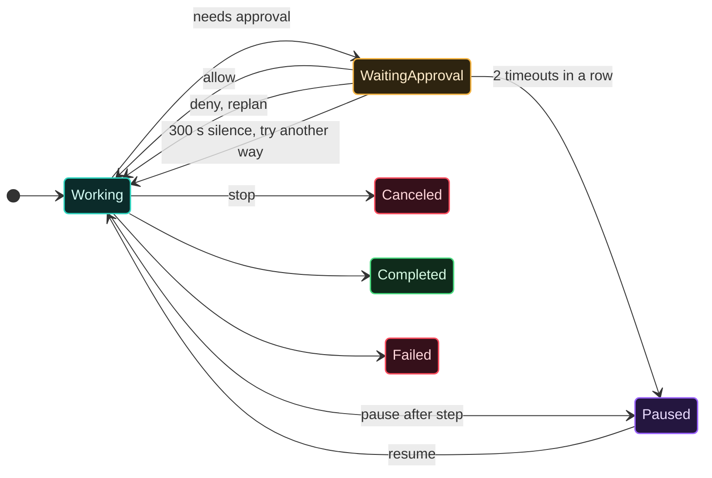

## Failure and recovery

| Failure | Behavior |
|---|---|
| No approval in 300 seconds | Request cancelled (not declined); model told "user did not respond"; two in a row auto-pause the task and notify |
| Two approval answers | First wins; second gets "already resolved" |
| An agent misses one readiness check | Nothing is shown. An agent counts as down from the second miss in a row, and a check that landed on a connection the agent had just closed is asked again at once, so a busy moment does not raise a false alarm; a real outage shows about five seconds later than it could |
| Voice agent down or busy | Main agent retries the push a few times; on restart the voice agent lists its open tasks and catches up; approval notifications still come from the gateway |
| Gateway down | Agents keep working; events wait in outboxes; clients cannot connect |
| Tool server crash | Error result goes to the model so it can replan; the server restarts on the next call |
| Stop during a tool call | MCP cancellation, running shell process killed, task ends canceled |
| LLM endpoint down | Banner; chat messages queue; a running task retries the call three times with increasing delays then fails with a notification; paused or waiting tasks are unaffected |
| Model window full mid-reply, tool call cut off, or empty reply | The call is retried once after compacting harder (keeping less word for word); if it fails again the task fails with a message that says what happened and how to fix it (a larger context length, a smaller task), and a notification. Any other model error fails the task the same way, immediately. A task is never left looking busy |
| Several tasks at once | They take turns on the model, one at a time, so their contexts never share its window; a waiting task shows as starting, flagged queued. A task waiting for an approval has let go of its turn |
| Voice model down, or its report unusable, when a direct task finishes | The chat shows the main agent's own words (“Done. …”); nothing waits on the voice model |
| Main agent down when a direct message is sent | The message stays queued and is retried; if the main agent refuses it, the message fails with the reason |
| A reply cannot be read aloud on the phone | The message bar says why (for example the speech service is down or the clip cannot be played), and the next reply plays normally |
| The model asks for a shell command on the deny list | The tool server refuses it at once and nobody is asked; the model is told the rule cannot be approved away and chooses another way |
| An agent's address is changed while a key is stored | The key is held back: Settings shows “typed for another address”, calls go out without it, and typing the key again makes it work for the new address |
| Main agent restart mid-task | Resumes from the last checkpoint; a call that started without a result is reported to the model as unknown and verified, never blindly re-run |
| Model still loading | "Loading model" status and timeline event; request timeouts and retries do not fire during a load |
| Model was unloaded while idle, or while a task waited for an approval | The next call loads it again and carries on; the task is not affected |
| The voice model mishears, or cannot hear | A result with more words than fit in the clip, an empty one, a clip over 30 seconds, or any error goes to Whisper instead |
| An agent dies without stopping its built-in llama.cpp server | The launcher stops that server before it starts the agent again, and `thursday down` stops any that are left; only servers run from Thursday's own llama.cpp folder |
| Model cannot load (not enough memory, bad file, llama.cpp not installed) | The Load button and the task report the engine's reason; for the built-in llama.cpp the process is stopped and the end of its log is shown |
| No API key, or a wrong one, for a cloud endpoint | The model call fails with the endpoint's refusal; the task fails with that message. Type the key in Settings |
| The provider lists the same model twice | Shown once in the model list |
| Phone off the tailnet | App shows "PC unreachable"; reconnect with a cursor replays missed events |
| The device cannot look up the PC's name (its Private DNS asks a server outside Tailscale) | The app says it cannot find the PC by its name and to set Private DNS to automatic or off; other failures to connect say to check Tailscale |
| Phone revoked or re-paired | A revoked phone shows that it was removed; pairing again restores the connection and the notification |
| Speech service down or a model cannot load | The microphone and speaker buttons report it; typing still works |
| A service crashes | The launcher restarts it after a delay; Monitor shows the restart count |
| Stale or lost read model | Rebuilt from agent replay endpoints, as far back as the retention period |
| An agent is down when the retention period is changed | The gateway keeps the new period and tells the agent on a later pass, once a minute, until it confirms; meanwhile the agent cleans up with the period it had |
| The tool server's log cannot be cleaned when a chat is deleted | The delete is not confirmed, so the gateway asks again until it is |
| A chat is deleted while a message is still waiting to be sent in it | The message fails with "The chat was deleted." and is not sent; a message that was already on its way is refused by the agents |
| A task finishes, or a reply is still being written, after its chat was deleted | Nothing is written or sent for the chat any more |
| The main agent starts a task but its answer is lost on the way back | The request is sent again under the same name and gets the task that was started; the work runs once |
| A model setting is saved, or Unload or Reload is pressed, while that model is answering | Refused with "The model is in use right now. Try again when it has finished."; nothing is changed and the reply goes on |

## Data handling and feedback

- Chats and history can be created, searched, renamed, and deleted. Deletes are confirmed in the app's own dialog and remove every record from every service, including the tool server's log of that chat's calls.
- Working data (how tasks were done: steps, traces, saved task state, tool call logs) is removed after the retention period chosen in Settings, General; "Until I delete it" removes nothing by age. Chats and their messages are never removed by age. Monitor shows how much is stored.
- Every list has loading, empty, and error states. Sends show queued, delivered, and failed states. Banners show dependency problems (for example the LLM endpoint down, cloud provider in use).
- A change on a Settings page is not applied until it is saved. On the dashboard, Save and Discard appear at the top right of Settings, beside the tabs, while the open tab has unsaved changes, and stay in view while the page scrolls; the Prompts tab uses the same two buttons ("Save as version N"). Leaving a tab with unsaved changes asks: Cancel, Discard, or Save. On the phone, leaving a page without saving discards the changes, and the page says so.
- Hidden screens do not poll; a client resumes by replaying events from its last cursor. Lists refresh when a project or chat is made, renamed, or deleted on another device.
