# Important Security Boundaries

The rules below are implemented, and the ones a test can check have automated tests (listener guard, device tokens and pairing limits, workspace sandbox, approvals, file views, key storage per provider, the llama.cpp download checks). There has been no independent security review.

## Assets and actors

- **Assets:** the files and shell of the PC (reachable by the tool server), chat and trace content (may contain file contents and command output), API keys, device tokens, the microphone on the PC and the phone, the Android app's signing key.
- **Actors:** the owner (single user); paired devices (equal power, revocable); the LLM agents (untrusted decision makers); external content the model reads (untrusted).

## Trust boundaries

```mermaid
%% svg: trust-boundaries
flowchart TB
  subgraph TN["Your tailnet"]
    phone(["Phone app<br/>device token in the Android Keystore"])
  end
  subgraph PC["Your PC"]
    direction TB
    ts("Tailscale Serve<br/>HTTPS front")
    dash(["Dashboard<br/>browser on localhost"])
    gw("Gateway<br/>two listeners")
    agents("Agents<br/>voice and main")
    speech("Speech service<br/>stores no audio")
    lm[("LM Studio or built-in llama.cpp<br/>local LLM")]
    tools("Tool server<br/>sandbox and policy")
    keys[("Credential store<br/>API keys")]
  end
  subgraph NET["Internet"]
    cloud[("Cloud LLM<br/>optional")]
  end
  phone -->|"1 HTTPS and device token"| ts
  ts -->|"2 proxy port, token always"| gw
  dash -->|"3 localhost port, trusted"| gw
  gw -->|"4 service token"| agents
  gw -->|"4 service token"| speech
  agents -->|"5 local"| lm
  agents -->|"6 stdio, policy enforced here"| tools
  agents -.->|"7 data leaves the PC"| cloud
  agents -->|"8 keys, write and read"| keys
  classDef client fill:#0f1d3d,stroke:#4d8dff,color:#dbe7ff,stroke-width:1.5px
  classDef edge fill:#1b1826,stroke:#8d81a6,color:#e9e4f5,stroke-width:1.5px
  classDef gateway fill:#0b2b2a,stroke:#2dd4bf,color:#d3fbf4,stroke-width:1.5px
  classDef agent fill:#24163f,stroke:#9b63ff,color:#eadcff,stroke-width:1.5px
  classDef tool fill:#0f2b1b,stroke:#4ade80,color:#d7fbe4,stroke-width:1.5px
  classDef speech fill:#33122a,stroke:#ff5c8a,color:#ffd9e6,stroke-width:1.5px
  classDef external fill:#1a1630,stroke:#c9a8ff,color:#f1e8ff,stroke-width:1.5px
  classDef danger fill:#35101a,stroke:#ff4d5e,color:#ffd6da,stroke-width:1.5px,stroke-dasharray:5 4
  class phone,dash client
  class ts edge
  class gw gateway
  class agents agent
  class tools tool
  class speech speech
  class lm,keys external
  class cloud danger
  style TN fill:#0b1226,stroke:#4d8dff,stroke-dasharray:6 4
  style PC fill:#0d0b16,stroke:#463d5c,stroke-dasharray:6 4
  style NET fill:#1c0a10,stroke:#ff4d5e,stroke-dasharray:6 4
```

Mermaid source

| # | Crossing | Rule |
|---|---|---|
| 1 | Tailnet device to TLS front | HTTPS; a device token on every call except pairing claim |
| 2 | TLS front to gateway | Goes only to the proxy listener, which always requires a device token |
| 3 | PC dashboard to gateway | The localhost listener, trusted; only software on the PC can reach it. It is separate from the proxy listener so proxied tailnet requests never look like localhost |
| 4 | Gateway to agents and the speech service | Localhost only, service token generated at setup and kept in `.env` |
| 5 | Agents to LM Studio or the built-in llama.cpp | Local. A built-in `llama-server` listens on 127.0.0.1 only, on a free port, and requires a random key that only the agent that started it knows |
| 6 | Main agent to tool server | stdio child process; the tool server enforces sandbox and policy |
| 7 | Agents to a cloud LLM | Everything in the model context leaves the PC; the UI marks this in Settings and in the chat header |
| 8 | Agents to the credential store | Each agent reads and writes only its own keys, one per provider; the store encrypts them for the signed-in Windows account |

## Guarantees

- **The model cannot approve its own actions.** Approval answers come only from a human action in a client or from stored allow rules, never from model output.
- **Sandbox and policy live in the tool server.** It resolves every path and refuses anything outside the project folder, including `..`, symlinks, junctions, short names, and UNC paths. Shell commands and deletes ask for approval regardless of any prompt. That check is for the paths given to the file tools. The shell is not confined to the folder: it starts there, but a command that was approved runs as you and can reach anything on the PC that you can. Approval is its control, and “always allow” for the shell in a chat removes that control for the chat until the rule is revoked in Tools. This is an accepted choice.
- **Allow always** is scoped to one chat, shown in Tools, revocable, and accompanied by a clear warning when chosen for shell.
- **Pairing codes** are created only through the localhost listener, are single use, and expire quickly. Device tokens are long and random, stored hashed on the PC and in the Android Keystore on the phone, and can be revoked. Pairing attempts are rate limited.
- **The dashboard is local only.** It is served on the localhost listener, which checks the Host and Origin of every request and needs a custom header on writes, so another website or a DNS-rebinding page cannot drive it. The proxy listener serves no pages, only the API with a device token.
- **Folder and file views:** a paired device can list folder names anywhere on the PC (to choose a project folder) and can read text files inside project folders (first 200 kB, read-only). This matches what a paired device could already do by asking the agent; nothing outside a project folder can be read, and nothing can be written this way.
- **Commands that are never run.** The tool server refuses some shell commands before anyone is asked, so neither an approval nor an “always allow” rule can let them through: erasing or repartitioning a disk, wiping files, deleting outside the project folder, deleting from the registry, changing the firewall, user accounts or other security settings of the PC, sending, publishing or fetching files over the network (web requests, file transfer tools, `git push`, package publishing, cloud storage uploads), making files on the PC reachable from other machines, and commands that hide their own text (an encoded command). The list reads the command as text: it catches the plain forms a model writes, not a command hidden inside a script file, so it is a guard beside the approval and not a sandbox. Installing packages and cloning a repository are not on the list.
- **Phone safeguards:** the app asks for the phone's lock-screen credential or fingerprint before changing Settings, and when Allow is pressed on an approval. The check on Allow is a setting of the device (Settings, App, **Fingerprint before allowing**; on unless turned off, and turning it off asks for the credential). A typed or spoken “yes” in the chat answers a waiting approval without that check; this is an accepted choice. An optional app lock (fingerprint or phone PIN) locks the whole app.
- **Speech:** audio recorded for push-to-talk goes to the gateway and the local speech service, and to the voice agent's model only when that is a built-in llama.cpp model on this PC; it is turned into text and dropped; replies are spoken from text. No audio is stored or sent off the PC. The apps ask for the microphone only when the button is first used; the phone's camera is used only to scan a pairing code.
- **App signing:** release builds of the Android app are signed with a key that stays outside the repository (`apps/android/keystore.properties` and the key file are git-ignored). Whoever holds that key can publish an update that phones will accept, so it is kept and backed up like a password.
- **Secrets:** model API keys live in the operating system's credential store (Windows Credential Manager, macOS Keychain, Linux Secret Service), one per agent and provider. A key is typed in Settings (on the phone, behind the phone's lock), passes through the gateway to the agent that stores it, and is never returned: the UI shows only whether one is set. The service token lives in `.env` (git-ignored; `.env.example` holds placeholders). Keys never appear in databases, traces, or logs; traces store request and response bodies but never headers.
- **Keys and providers:** a key is stored for one agent and one provider, so changing an agent's provider never sends the old provider's key to the new address. A key is also tied to the address it was typed for: when an agent's address is changed, the stored key is held back, Settings says so, and nothing is sent with it until the key is typed again for the new address. The same holds for a key from `.env`, which goes only to the `.env` address.
- **Downloaded llama.cpp:** setup downloads only from the official llama.cpp releases, refuses any file whose SHA-256 does not match the one the release publishes (or that has none), and refuses an archive that would write outside its own folder. The checksum comes from the same place as the file, so this guards against a damaged or swapped download, not against a compromised release.
- **Model files:** the built-in llama.cpp loads only files inside the models folder you chose; a model name that resolves outside it is refused.
- **Stopping leftover servers:** the launcher stops a llama.cpp server only when its program file is inside Thursday's own llama.cpp folder (or `LLAMACPP_DIR`). A stale process record, or LM Studio's own server, is never stopped.
- **The chat id on a tool call** is set by the main agent's code as call metadata, never by the model, and is only ever recorded: no tool reads it, and the tool server ignores one that does not have the shape of an id. The clean-up commands accept the same shape only, so an id can never name a file outside the log folder.
- **Untrusted output:** model and tool output is rendered as sanitized text or markdown, never as HTML; tool output and stored bodies are size-capped.
- **Auditability:** the tool server logs every call and permission decision in its own SQLite; the gateway shows approvals and tool calls in the timeline and trace. Each call is recorded with the chat it was made for, so deleting a chat removes its calls from that log too. Traces, the saved state of finished tasks, and the call log are kept for the retention period chosen in Settings (30 days by default; "until I delete it" keeps them).
- **Backups** contain transcripts, projects, and device token hashes, so the backup folder must be treated as sensitive. `.env` and API keys are never included.

## Abuse and failure cases to verify

A paired phone can replace an agent's API key or point an agent at another endpoint (behind the phone's lock), which would send chat content there: revoke a lost phone at once. Prompt injection through file content or web pages must not widen permissions; a proxied tailnet request must not reach the localhost listener; sandbox escape attempts on Windows paths; a lost phone token is revocable and cannot approve risky actions without the phone credential; replayed or duplicate approval answers are harmless; the tool server keeps enforcing policy after a main-agent restart.

## Things to know

- Trace bodies are stored as they were sent and are not redacted, so a trace can hold whatever a file or a command printed. They are kept for the retention period chosen in Settings.
- Public certificate logs list the Tailscale machine name; rename the machine first if its name is sensitive.
